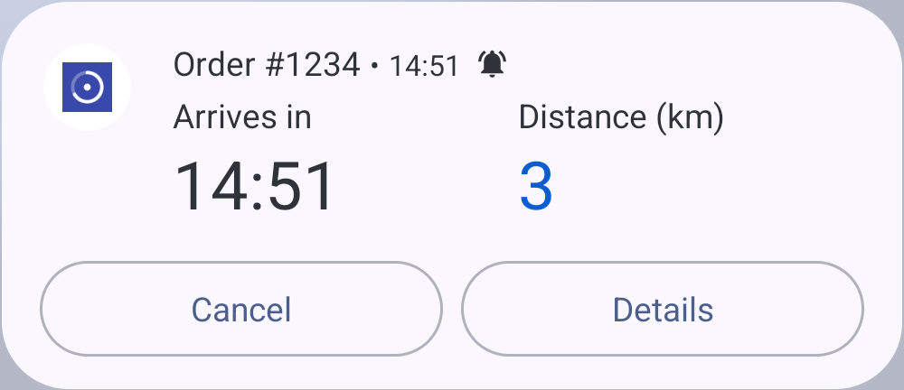
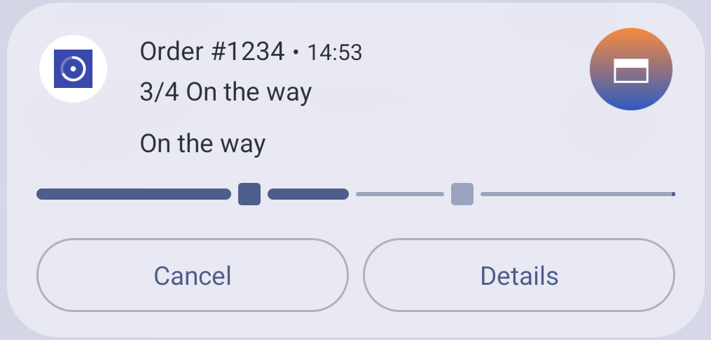
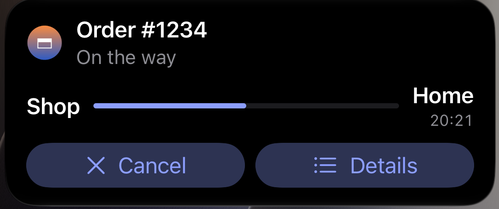

# live_updates

iOS **Live Activities** and Android **Live Update** notifications with one Dart API.

- **One API for both platforms:** start, update and end with a title, body,
  progress, a system-counted timer, an image, buttons and a tap route.
- **Scheduling and ending at a time:** show a live update later, even if
  the app is not running then (iOS 26+ and Android), and switch it to ended
  content such as "Delivered" at a set time.
- **iOS 17.2+:** Lock Screen and Dynamic Island, with five built-in layouts
  (standard, timer, metrics, stepper, journey) and a SwiftUI widget you
  generate with one command and can customize.
- **Android:** `ProgressStyle` notifications on Android 16+, promoted to a
  Live Update with a status bar chip when the system allows it (Android 16
  QPR1 and later), and an ongoing notification with a progress bar on older
  versions.
- **Remote updates:** start, update and end from your server (APNs on iOS, a
  data message on Android; optional FCM helper:
  [`live_updates_fcm`](https://pub.dev/packages/live_updates_fcm)).
- **Lightweight:** no platform channels (native code is called through
  [FFIgen](https://pub.dev/packages/ffigen) and
  [JNIgen](https://pub.dev/packages/jnigen)), and runtime dependencies are only
  Dart and Flutter team packages (`ffi`, `objective_c`, `jni`, `crypto`,
  `meta`). Other platforms are a safe no-op.

In this README, a *live update* is either a Live Activity (iOS) or a Live
Update notification (Android).

> **Status:** 0.4.x. Breaking changes come with a new minor version (0.5.0); pin the version you test with.

| iOS Lock Screen | iOS Dynamic Island |
| --- | --- |
|  |  |
| **Android 16** | **Android 17** |
|  |  |

Screenshots of the example app in this repository.

## Contents

- [Platform support](#platform-support)
- [Getting started](#getting-started)
- [Platform guidelines](#platform-guidelines)
- [Platform limits](#platform-limits)
- [Usage](#usage)
- [Customizing the iOS widget](#customizing-the-ios-widget)
- [Remote updates](#remote-updates)
- [Upgrading](#upgrading)
- [How it works](#how-it-works)

## Platform support

**Requirements:** Flutter 3.50+, iOS 15.0+, Android 7.0 (API 24)+. Live
Activities need iOS 17.2: on iOS 15.0 to 17.1 every call does nothing and
`isSupported()` returns `false`.

| | iOS 17.2+ | Android 16+ | Android 7–15 | iOS 15.0–17.1, other |
| --- | --- | --- | --- | --- |
| Start / update / end | Live Activity | Live Update (when promoted) | Ongoing notification | no-op |
| Progress | ✓ | `ProgressStyle` (segments, points) | progress bar | |
| Timer (countdown, stopwatch) | ✓ | chronometer | chronometer | |
| Metrics | `metrics` layout | Android 17 `MetricStyle`, else text | text | |
| Steps, journey | `stepper`, `journey` layouts | progress segments and points, text | progress bar, text | |
| Semantic colors | – | Android 17+ | – | |
| Buttons (`actions`) | ✓ | ✓ | ✓ | |
| Image | ✓ | large icon (not with Android 17 metrics) | large icon | |
| Tap route (`onTap`) | ✓ | ✓ | ✓ | |
| Scheduled start (`schedule`) | iOS 26+ | alarm | alarm | |
| Ended content at a time (`endAt`) | stale date | alarm | alarm | |
| Lifecycle events (`states`, `onStarted`) | ✓ | ✓ | ✓ | |
| Live Activity push tokens | ✓ | – (FCM via `live_updates_fcm`) | – (FCM via `live_updates_fcm`) | |
| Remote updates | push to the system (APNs, or FCM), no app code | data message → `handleRemotePayload` | data message → `handleRemotePayload` | |
| One push to many devices | broadcast channels (iOS 18+) | FCM topics | FCM topics | |

"Android 16+" shows a Live Update when the system promotes it (Android 16
QPR1 and later); otherwise it is an ongoing notification with the same
features.

## Getting started

```bash
flutter pub add live_updates
```

### iOS

1. From your app's root directory, generate the widget extension:

   ```bash
   dart run live_updates:create_widget
   ```

   This writes `ios/LiveUpdatesWidget/`, adds a *LiveUpdatesWidget* extension
   target (iOS 17.2) to `Runner.xcodeproj`, sets `NSSupportsLiveActivities`,
   and sets up the URL scheme for taps (`liveupdates-<bundle id>`) and the App
   Group for [images](#images). It needs Ruby with the `xcodeproj` gem
   (included with CocoaPods) and offers to run
   `gem install --user-install xcodeproj` if it is missing.

   - **Deployment target:** only the widget extension needs iOS 17.2; the
     app can target iOS 15.0 or later.
   - **Flavors:** every build configuration (for example `Debug-dev`,
     `Release-prod`) gets a widget bundle id and an App Group derived from
     its app bundle id (`LIVE_UPDATES_APP_GROUP` build setting). If the bundle
     id is set in an `.xcconfig` instead of the project, pass
     `--app-group group.<bundle id>`.
   - **Manual setup:** pass `--no-xcode` to only write the files, then follow
     [Manual setup](#manual-setup).

2. Open the project in Xcode once and select a signing team for the new target.

3. For push updates, add the **Push Notifications** capability to the Runner
   target.

#### Manual setup

With `--no-xcode` only the widget sources are written. Then, in Xcode:

1. File > New > Target > Widget Extension named `LiveUpdatesWidget`
   (no Live Activity or configuration intent templates), deployment target
   17.2, and replace its generated Swift files with the files from
   `ios/LiveUpdatesWidget/`.
2. Add `LiveUpdatesActionIntent.swift` to both the Runner and the widget
   target (Target Membership).
3. Runner `Info.plist`: add `NSSupportsLiveActivities` = YES and a URL type
   with the scheme `liveupdates-$(PRODUCT_BUNDLE_IDENTIFIER)`.
4. For images: add the App Groups capability with the same group to both
   targets and set `LiveUpdatesAppGroup` to that group in both Info.plist
   files.

### Android

No native setup is required: the plugin declares `POST_NOTIFICATIONS` and
`POST_PROMOTED_NOTIFICATIONS`. Call `LiveUpdates.requestPermission()` before
starting on Android 13+; it asks for `POST_NOTIFICATIONS` only
([source][android-permission]). Also add a single-color status bar icon and
make it the default icon (see [Icons](#icons)); without one, Android shows the
app icon as a solid shape.

`POST_PROMOTED_NOTIFICATIONS` is required, in addition to
`POST_NOTIFICATIONS`, for a notification to be promoted to a Live Update
(Android 16 QPR1 and later). It is granted at install time without a prompt,
and users can turn it off per app in Settings.
([source][android-promoted-permission], [source][android-live-update])

If your app only uses `AndroidLiveUpdateMode.ongoing` or
`AndroidLiveUpdateMode.classic`, which never ask for promotion, you can remove
the permission in `android/app/src/main/AndroidManifest.xml`:

```xml
<manifest xmlns:android="http://schemas.android.com/apk/res/android"
    xmlns:tools="http://schemas.android.com/tools">
  <uses-permission
      android:name="android.permission.POST_PROMOTED_NOTIFICATIONS"
      tools:node="remove" />
  ...
</manifest>
```

Android only promotes a notification to a Live Update when the build supports
it, the user allows it (`LiveUpdates.canPostPromotedNotifications()`), and the
notification meets the system's criteria. Otherwise it stays a regular
ongoing notification.

## Platform guidelines

Both platforms limit what these surfaces are for. Follow Apple's Human
Interface Guidelines for Live Activities and Android's
[Live Update guidance](https://developer.android.com/develop/ui/views/notifications/live-update):

- Use them for ongoing, user-initiated, time-sensitive activities, such as a
  ride, a food order, navigation, a call or a sports score.
- Do not use them for ads, promotions, chat messages, alerts, upcoming
  calendar events or quick access to app features.
- Do not start them for something the user did not ask for. On Android set
  `AndroidLiveUpdateOptions(mode: AndroidLiveUpdateMode.ongoing)` (or
  `classic`) for anything that is not a Live Update; it then stays a regular
  notification.
- Do not bring back an update the user dismissed. On Android `update` fails
  for a dismissed update, and remote `update` payloads for it are ignored.
  A remote `start` (or an iOS push-to-start) shows it again: send one only
  for a new activity. `startOrUpdate` does not show a dismissed key again
  until you `end` it on
  Android; iOS cannot always tell a dismissal from other ends (for example
  while the app is not running), so there the key can start again once the
  system no longer lists the dismissed activity. Use a new key for a new
  activity.
- Keep `shortCriticalText` under 7 characters (see
  [Platform limits](#platform-limits)).

## Platform limits

Each limit links to the platform documentation it comes from. The systems
change between OS versions, so check the source when something behaves
differently.

### iOS

- **Duration:** a Live Activity can run for up to 8 hours. Then the system
  ends it and removes it from the Dynamic Island; the Lock Screen keeps it
  for up to 4 more hours (12 hours in total). For longer activities, end the
  activity and start a new one, or use a regular notification.
  ([source][ios-activitykit])
- **After `end`:** the final content stays on the Lock Screen for up to
  4 hours. `dismissAfter` longer than that is capped at 4 hours.
  ([source][ios-activitykit]) From 0.4.0 the plugin leaves out buttons, the
  timer and timer or stopwatch metrics, which would keep running (as on
  Android); an `end` sent by push shows what the server sends. Without
  `finalContent` it starts from the content as the app last received it,
  which can be older than a push update shown a moment ago: if you update
  by push, pass `finalContent` to `end`.
- **Size:** the attributes and the content together must stay under 4 KB,
  for local updates and push payloads alike. Long texts, many buttons and
  large `extra` maps count toward it. ([source][ios-activitykit])
- **Height:** the Lock Screen view is 84 to 160 points high; content beyond
  that is cut off. ([source][ios-hig-specs])
- **User settings:** users can turn off Live Activities for your app in
  Settings. `LiveUpdates.isSupported()` returns `false` then, and `start`
  throws a `LiveUpdateException`. Check it before you offer a "Track on Lock
  Screen" option. ([source][ios-activitykit])
- **Number of activities:** the system limits how many Live Activities can
  run at once (per app and per device; the exact number varies). Handle a
  `LiveUpdateException` from `start`, and prefer one activity that you update
  over several. ([source][ios-activitykit])
- **Updates from the app:** `update` and `end` only run while your app runs.
  To keep an activity current while the app is suspended or closed, update
  it with [push notifications](#remote-updates). ([source][ios-push])
- **Push budget:** iOS limits pushes with `apns-priority: 10` per hour and
  throttles them beyond that budget. Send routine updates with
  `apns-priority: 5` (not counted) and use `10` only for updates the user
  must see at once. For many updates per hour (such as a live score), add
  `NSSupportsLiveActivitiesFrequentUpdates` = YES to the Runner `Info.plist`;
  users can still turn frequent updates off in Settings. ([source][ios-push])
- **Where it appears:** the Lock Screen of iPhone and iPad, the Dynamic
  Island on iPhone models that have one, StandBy, the Mac menu bar, the
  Apple Watch Smart Stack and CarPlay. Devices without the Dynamic Island
  show the Lock Screen view as a banner for updates with an alert. Buttons do
  nothing in CarPlay, so make sure the content works without them.
  ([source][ios-hig])

### Android

- **Promotion:** besides the requirements in
  [Getting started](#android), Android only promotes notifications on a
  channel whose importance is above "min". If you pass your own
  `channelId`, do not create that channel with `IMPORTANCE_MIN`. Device
  makers can apply additional criteria. ([source][android-live-update])
  `LiveUpdate.isPromoted()` tells you whether a shown update was promoted:
  unlike `LiveUpdates.canPostPromotedNotifications()`, which only reports
  the permission, it reflects the system's decision for that notification.
- **User settings:** users can demote or dismiss a Live Update and turn off
  Live Updates for your app in Settings. Updates then appear as regular
  ongoing notifications. `LiveUpdates.canPostPromotedNotifications()` tells
  you whether Live Updates are turned off for your app, and
  `LiveUpdate.isPromoted()` whether one shown update is promoted. To send
  users to the setting, open the
  `Settings.ACTION_APP_NOTIFICATION_PROMOTION_SETTINGS` intent (the Live
  Update guide names it `ACTION_MANAGE_APP_PROMOTED_NOTIFICATIONS`, which is
  not in the SDK) with `Settings.EXTRA_APP_PACKAGE`; some devices have no
  matching screen, so handle that case. ([source][android-live-update],
  [source][android-promotion-settings])
- **Status bar chip:** the chip is at most 96 dp wide. `shortCriticalText`
  is shown in full only if it is shorter than 7 characters; longer text is
  cut, or only the icon is shown when less than half of it fits. Without
  `shortCriticalText`, a countdown timer at least 2 minutes in the future is
  shown as the remaining time. ([source][android-live-update])
- **Permissions:** on Android 13 and later nothing is shown until the user
  grants the notification permission, including updates started by a
  remote message. ([source][android-permission]) While notifications are
  turned off for the app or for its channel, `start`, `startOrUpdate` and
  `update` throw a `LiveUpdateException`, as on iOS with Live Activities
  turned off (from 0.4.0), and so do `schedule` and `reschedule` for a time
  that has passed. A schedule whose time comes then shows nothing. `isSupported()` tells you beforehand
  whether notifications are on for the app; a turned-off channel shows only
  in the exception.
- **After `end`:** from 0.4.0 the final content (or the content shown last)
  stays as a regular notification for up to 4 hours, like on iOS, and the
  user can swipe it away. Running timers (and timer or stopwatch metrics)
  are left out of it, so a countdown does not run past zero. This applies to
  `end` and remote `end` payloads; an update removed by `maxDuration`,
  `timeoutAfter` or `removeAtEnd` is removed at once. Unlike iOS, Android
  does not report `dismissed` when the ended notification goes away.
  `dismissAfter` longer than 4 hours is capped at 4 hours; `Duration.zero`
  removes it at once. Below Android 8.0 the system cannot remove a
  notification later, so only `finalContent` stays there, until the user
  dismisses it ([source][android-timeout-after]).
- **Sound:** the first post of a live update plays the sound of its
  channel, while iOS starts a Live Activity silently. The plugin creates its
  channels with the default importance; to start silently, create your own
  channel with `IMPORTANCE_LOW` before the first post and pass its
  `channelId` (`alert: true` then plays no sound either). Users can change
  a channel's sound in Settings. ([source][android-channels])
- **Duration:** from 0.3.0 a live update is removed 8 hours after it
  started by default, like on iOS (`AndroidLiveUpdateOptions.maxDuration`;
  `null` for no limit).
- **Exact alarms:** scheduled updates and `endedContent` are on time only
  while the app may set exact alarms (`SCHEDULE_EXACT_ALARM`, from Android
  14 denied by default for most newly installed apps that target Android 13
  or higher). If the user takes
  the permission away, Android cancels the exact alarms without telling the
  app; the plugin sets them again (inexact) the next time the app starts.
  Otherwise Android delivers alarms within a window of at least 10 minutes.
  ([source][android-alarms], [source][android-14-exact-alarms])

[ios-activitykit]: https://developer.apple.com/documentation/activitykit/displaying-live-data-with-live-activities
[ios-request-start]: https://developer.apple.com/documentation/activitykit/activity/request(attributes:content:pushtype:style:alertconfiguration:start:)
[ios-stale-date]: https://developer.apple.com/documentation/activitykit/activitycontent/staledate
[android-alarms]: https://developer.android.com/develop/background-work/services/alarms
[android-14-exact-alarms]: https://developer.android.com/about/versions/14/changes/schedule-exact-alarms
[android-channels]: https://developer.android.com/develop/ui/views/notifications/channels
[android-timeout-after]: https://developer.android.com/reference/android/app/Notification.Builder#setTimeoutAfter(long)
[ios-push]: https://developer.apple.com/documentation/activitykit/starting-and-updating-live-activities-with-activitykit-push-notifications
[ios-hig]: https://developer.apple.com/design/human-interface-guidelines/live-activities
[ios-hig-specs]: https://developer.apple.com/design/human-interface-guidelines/live-activities#Specifications
[android-live-update]: https://developer.android.com/develop/ui/views/notifications/live-update
[android-permission]: https://developer.android.com/develop/ui/views/notifications/notification-permission
[android-promoted-permission]: https://developer.android.com/reference/android/Manifest.permission#POST_PROMOTED_NOTIFICATIONS
[android-promotion-settings]: https://developer.android.com/reference/android/provider/Settings#ACTION_APP_NOTIFICATION_PROMOTION_SETTINGS

## Usage

### Start, update and end

```dart
import 'package:live_updates/live_updates.dart';

Future<void> trackOrder() async {
  if (!await LiveUpdates.requestPermission()) return;

  final update = await LiveUpdates.start(
    const LiveUpdateContent(
      title: 'Order #1234',
      body: 'Preparing',
      progress: 0.1,
      route: '/orders/1234',
      android: AndroidLiveUpdateOptions(shortCriticalText: '10 min'),
    ),
  );

  await update.update(
    const LiveUpdateContent(title: 'Order #1234', body: 'On the way', progress: 0.6),
  );

  // Lifecycle: stale (at endAt), ended, dismissed (e.g. swiped away).
  update.states.listen((state) => print(state));

  // The last content stays for 5 minutes: on the iOS Lock Screen, and on
  // Android as a regular notification the user can swipe away. Without
  // dismissAfter it stays up to 4 hours; Duration.zero removes it now.
  await update.end(dismissAfter: const Duration(minutes: 5));
}
```

### Taps and running updates

```dart
// Taps on a live update deliver its route. Only routes that one of the
// app's live updates carries are delivered, but treat them like any deep
// link: validate before acting on them.
LiveUpdates.onTap.listen((route) => router.go(route));

// Live updates still running, e.g. after an app restart.
final running = await LiveUpdates.active();

// Live updates that appear while the app runs, including remote starts.
LiveUpdates.onStarted.listen((update) => track(update));

await LiveUpdates.endAll();
```

### One live update per key

When your data already has an id, use it as the key. Calling
`startOrUpdate` again updates the same live update instead of starting a
duplicate, and `find` gets it back after an app restart:

```dart
await LiveUpdates.startOrUpdate('order-1234', content);
final update = await LiveUpdates.find('order-1234');
```

On Android the key is the update's id and is the same as `live_updates_id`
in remote payloads, so the app and the server address the same notification.
On iOS the key is stored in the activity's attributes; a push-to-start can set
it with `"attributes": {"key": "order-1234"}`. Unlike a remote `start` on Android,
which replaces the notification, a push-to-start with the key of a running
activity adds a second one (iOS cannot replace an activity, and does not say
which of the two is newer). Send a push-to-start only for a key that is not
running, and update a running one with its push token instead.

### Scheduling

`schedule` shows a live update at a later time, even if the app is not
running then. At that time it behaves like `startOrUpdate`: a running update
with the key is updated, otherwise one starts.

```dart
if (await LiveUpdates.canSchedule()) {
  final scheduled = await LiveUpdates.schedule(
    'order-1234',
    content,
    at: DateTime.now().add(const Duration(hours: 1)),
  );
  // Later: move it, change it or cancel it.
  await scheduled.reschedule(at: DateTime.now().add(const Duration(hours: 2)));
  await scheduled.cancel();
}
final pending = await LiveUpdates.scheduled();
```

- Scheduling again with the same key replaces the schedule. A time that is
  not in the future shows the update now.
- A scheduled update is not part of `active()` or `find` until it is shown;
  then it appears on `onStarted` while the app runs. `startOrUpdate` does
  not cancel a schedule; use `cancelScheduled`, `ScheduledLiveUpdate.cancel`
  or `cancelAllScheduled`. `endAll()` ends running updates and cancels
  schedules too, such as when the user logs out or switches accounts;
  `endAll(includeScheduled: false)` leaves schedules alone.
- Schedules live on the device, and only the app can cancel them. If the
  user is logged out on the server or does not open the app, a schedule
  still shows its update at its time; on iOS a push cannot cancel it either,
  because a scheduled activity gets its push token only once it starts. Call
  `endAll()` at logout and at app start when the session is no longer valid,
  and keep sensitive details out of scheduled content (or give it a
  `publicContent`, see [Hiding content on the Lock Screen](#hiding-content-on-the-lock-screen)).
- **iOS 26 and later:** the system starts the Live Activity at that time
  ([source][ios-request-start]) and presents an alert:
  `IosLiveUpdateOptions.alert`, or else the title and body. Call `schedule`
  and `reschedule` while the app is in the foreground; they throw a
  `LiveUpdateException` in the background and before iOS 26 (check
  `canSchedule`). ActivityKit drops content updates made before the start,
  so `reschedule` replaces the scheduled activity. With `pushUpdates`, the
  activity's push token is issued only once it starts. If an update with the
  key is running at that time, the system shows both until the app runs; the
  plugin then ends the older one. In tests the activity started 3 to 4
  seconds after the requested time. Turning off Live Activities for the app
  in Settings blocks new requests but does not cancel a schedule made
  before: in tests (iOS 27.2) it still started at its time, with its alert
  and sound. Call `cancelAllScheduled()` when the user opts out in your
  app.
- **Android:** an alarm posts the notification. It is on time only with
  exact alarms: add `SCHEDULE_EXACT_ALARM` to your app's manifest (this
  package does not declare it). From Android 14 it is denied by default for
  most newly installed apps that target Android 13 or higher, so ask the user with
  `LiveUpdates.openExactAlarmSettings()` and check
  `LiveUpdates.canScheduleExactly()`
  ([source][android-alarms], [source][android-14-exact-alarms]). Without it
  the update appears within `AndroidScheduleOptions.window` (10 minutes by
  default, which is also the shortest window Android allows from Android 12).
  Schedules survive reboots, app updates and clock changes. A force-stopped
  app gets no alarms; the plugin sets them again the next time the app
  starts and then shows overdue updates.

```xml
<!-- android/app/src/main/AndroidManifest.xml, for exact timing -->
<uses-permission android:name="android.permission.SCHEDULE_EXACT_ALARM" />
```

### Ending at a time

`endAt` says when the activity is over, such as the delivery time.
`endedContent` is what the update shows from then on, even if the app is not
running:

```dart
await LiveUpdates.startOrUpdate(
  'order-1234',
  LiveUpdateContent(
    title: 'Order #1234',
    body: 'On the way',
    timer: LiveUpdateTimer.countdown(eta),
    endAt: eta,
    endedContent: const LiveUpdateEndedContent(
      title: 'Order #1234',
      body: 'Delivered',
    ),
  ),
);
```

- At `endAt` the update reports `LiveUpdateState.stale` on both platforms
  and keeps running: it stays in `active()` and `find`, until the app ends
  it or it reaches its time limit. Updating it with new content makes it
  active again.
- Without `endedContent`, nothing visible changes at `endAt`.
- `LiveUpdateEndedContent` can also set an `icon` (used instead of the
  content's icon; platform icon options still win) and an `image` (without
  one, the ended display shows no image).
- **iOS:** `endAt` becomes the activity's stale date (an explicit
  `IosLiveUpdateOptions.staleDate` wins), and the generated widget shows
  `endedContent` once the activity is stale ([source][ios-stale-date]). In
  tests the system marked the activity stale about a minute after the stale
  date. The activity keeps running until the app ends it or the system
  removes it after at most 8 hours (see [Platform limits](#ios)). The
  switch lives in your layout file: one generated before 0.3.0 needs it
  added (see [Upgrading](#upgrading)).
- **Android:** an alarm replaces the notification with `endedContent` as a
  regular notification (title, body, icon, image, color and tap route; no
  progress, timer or buttons) that is no longer ongoing or promoted, so the
  user can swipe it away (reported as `dismissed`; as with any dismissal,
  `startOrUpdate` then does not show the key again until you `end` it). Like scheduling, the
  switch is on time only with exact alarms, otherwise within 10 minutes.
  `AndroidLiveUpdateOptions(removeAtEnd: true)` removes the notification at
  `endAt` instead, exactly ([source][android-timeout-after]).
- **Android time limit:** `AndroidLiveUpdateOptions.maxDuration` removes the
  notification that long after the update started (later updates do not
  reset it), even if the app is not running. It defaults to 8 hours, like
  the iOS limit; pass `maxDuration: null` for no limit.

### Buttons

```dart
const LiveUpdateContent(
  title: 'Order #1234',
  actions: [
    LiveUpdateAction(
      id: 'cancel',
      title: 'Cancel',
      icon: LiveUpdateIcon.symbol('xmark'),
      requiresUnlock: true,
    ),
    LiveUpdateAction(id: 'track', title: 'Track', opensApp: true),
  ],
);

LiveUpdates.onAction.listen((event) {
  // event.updateId, event.actionId
});
```

Where a press is delivered:

| Button | App in the foreground | App in the background or not running |
| --- | --- | --- |
| Without `opensApp` | `onAction`; the [background handler](#handling-presses-while-the-app-is-not-running) if no listener takes it | the background handler; without one, queued until the app listens in the foreground |
| `opensApp: true` | `onAction`; the background handler if no listener takes it within 5 seconds | opens the app, then `onAction`; the background handler if no listener takes it within 5 seconds |

- Buttons without `opensApp` run without opening the app: on iOS through
  `LiveUpdatesActionIntent` (a `LiveActivityIntent` that `create_widget`
  compiles into both the app and the widget), on Android through a broadcast
  receiver. Use `opensApp: true` when the press must open the app.
- `LiveUpdate.actions` receives only that update's presses; presses of other
  updates go to `onAction` or the background handler.
- Presses work on the Lock Screen without unlocking the device. Set
  `requiresUnlock: true` on buttons with consequences, such as cancelling an
  order: iOS asks for Face ID or the passcode first, and Android 12+ asks the
  user to unlock.
- Android shows up to three actions. On iOS keep labels short: the whole
  content must stay under ActivityKit's 4 KB limit.

#### Handling presses while the app is not running

Register a background handler to act on a press immediately, even when the
app is not running. The plugin starts a headless Flutter engine, runs the
handler and shuts the engine down:

```dart
import 'package:flutter/widgets.dart';
import 'package:live_updates/live_updates.dart';

@pragma('vm:entry-point')
Future<void> onBackgroundAction(LiveUpdateActionEvent event) async {
  if (event.actionId == 'cancel') {
    await api.cancelOrder(event.updateId);
    final updates = await LiveUpdates.active();
    await updates
        .where((u) => u.id == event.updateId)
        .firstOrNull
        ?.end(dismissAfter: Duration.zero);
  }
}

Future<void> main() async {
  WidgetsFlutterBinding.ensureInitialized();
  await LiveUpdates.setBackgroundActionHandler(onBackgroundAction);
  runApp(const App());
}
```

- It must be a top-level or static function with
  `@pragma('vm:entry-point')`, and it has limited time (about 9 seconds on
  Android, 25 seconds on iOS).
- live_updates itself works in the handler. On iOS, other plugins that use
  platform channels need to be registered for the background engine:

  ```swift
  // AppDelegate.swift
  LiveUpdatesPlugin.setPluginRegistrantCallback { registry in
    GeneratedPluginRegistrant.register(with: registry)
  }
  ```

  On Android, plugins are registered automatically.

### Timers

A countdown or a stopwatch keeps running between updates because the system
counts it: iOS draws it in the widget template, Android shows the
notification's chronometer. Use it instead of updating a text every second,
which uses up the update budget.

```dart
LiveUpdateContent(
  title: 'Order #1234',
  timer: LiveUpdateTimer.countdown(eta), // or LiveUpdateTimer.stopwatch(startedAt)
);
```

On iOS a countdown stops at zero; Android keeps counting below zero, so update
or end the live update when the time is up.

### Layouts

Describe what the update is about, then choose how the iOS Lock Screen shows
it with `IosLiveUpdateOptions.layout`. The data is shared: Android uses the
same fields in its own way, so one content serves both platforms.

```dart
LiveUpdateContent(
  title: 'Order #1234',
  body: 'On the way',
  progress: 0.6,
  timer: LiveUpdateTimer.countdown(eta),
  metrics: [
    LiveUpdateMetric.timer('Arrives in', eta),
    LiveUpdateMetric.decimal('Distance', 1.2, unit: 'km'),
  ],
  steps: const LiveUpdateSteps(
    ['Ordered', 'Preparing', 'On the way', 'Delivered'],
    current: 2,
  ),
  journey: const LiveUpdateJourney(from: 'Shop', to: 'Home', toDetail: '18:30'),
  ios: const IosLiveUpdateOptions(layout: IosLiveUpdateLayout.stepper),
);
```

| Layout | iOS Lock Screen | Data | Android |
| --- | --- | --- | --- |
| `standard` (default) | image, title, body, progress bar | `progress` | progress bar |
| `timer` | a large countdown or stopwatch | `timer` | chronometer |
| `metrics` | up to three labeled values | `metrics` | Android 17 `MetricStyle` (not in `classic`); otherwise number and text metrics in the text |
| `stepper` | stages as dots, the current one highlighted | `steps` | Android 16+ progress segments and points; "2/4 Preparing" in the text |
| `journey` | from and to with the progress between them | `journey`, `progress` | "Shop → Home" in the text |

Similar content on each platform (the example app; iOS 27 Lock Screen,
Android 17 notification shade):

| Layout | iOS | Android Live Update | Android ongoing notification |
| --- | --- | --- | --- |
| `standard` |  |  |  |
| `timer` |  |  |  |
| `metrics` |  |  |  |
| `stepper` |  |  |  |
| `journey` |  |  |  |

Android has no layout setting; it shows the data that the content carries.
The Live Update column is `AndroidLiveUpdateMode.liveUpdate` on builds that
support promoted notifications (Android 16 QPR1 and later); metrics use
`MetricStyle` only on Android 17. The ongoing notification column is
`AndroidLiveUpdateMode.classic`, which is also what Android 15 and earlier
show.

A layout whose data is missing falls back to `standard`. The expanded Dynamic
Island shows the metrics, steps or journey of the chosen layout in place of
the body (there is no room for both), and buttons stay at the bottom of every
layout. The layout can change with each update. For a layout of your own, see
[Custom layouts](#custom-layouts).

### Colors and the Dynamic Island

`IosLiveUpdateOptions(color: ..., backgroundColor: ..., foregroundColor: ...)`
sets the accent (progress, buttons, timer, Dynamic Island keyline), the Lock
Screen background and its text color, like `AndroidLiveUpdateOptions.color`
on Android.

- In our tests on iOS 27 (device and simulator), the default Lock Screen
  card was black in Light and Dark Mode alike. Apple's guidelines describe a
  light background in Light Mode, which other versions or setups may show.
  The Dynamic Island is always black. Choose an accent that reads well on
  dark and on light backgrounds.
- With a custom background, set the text color too, for example
  `backgroundColor: Color(0xFFFFFFFF), foregroundColor: Color(0xFF000000)`.
- While the Always-On display dims the Lock Screen, the system colors are
  used.

Choose what the small Dynamic Island areas show:

```dart
ios: const IosLiveUpdateOptions(
  extra: {'gate': 'B12'},
  compactLeading: IosIslandContent.timer,           // default: icon
  compactTrailing: IosIslandContent.extra('gate'), // or progress, title, body
  minimal: IosIslandContent.progress,               // or icon, ...
),
```

If the chosen content is missing (such as `progress` without a progress), the
default is shown. Text is left out when the island is narrow, for example in
landscape on iOS 27. A layout file generated by an older version may ignore
these options; see [Upgrading](#upgrading).

### Android display modes

`AndroidLiveUpdateOptions.mode` chooses how Android 16 and later show the
update (older versions always show a regular ongoing notification with a
progress bar):

| Mode | Android 16+ look | Promoted to a Live Update |
| --- | --- | --- |
| `liveUpdate` (default) | `ProgressStyle` / Android 17 `MetricStyle` | requested |
| `ongoing` | `ProgressStyle` / Android 17 `MetricStyle` | no |
| `classic` | the same as Android 15 and earlier | no |

Use `liveUpdate` only for activities that fit Android's Live Update guidance,
`ongoing` for other activities that benefit from the richer progress, and
`classic` for the same look on every version (the body is always shown,
metrics are added to the text, and segments, points and semantic colors are
not used).

### Alerts

Set `alert` on content the user must notice, such as "Your order is here".
The device plays a sound and may light up the screen or show a banner:

```dart
await LiveUpdates.startOrUpdate(
  'order-1234',
  const LiveUpdateContent(
    title: 'Order #1234',
    body: 'At your door',
    alert: LiveUpdateAlert(), // or LiveUpdateAlert(title: ..., body: ...)
  ),
);
```

- **iOS:** an update (or a scheduled start) shows the alert, with the
  content's title and body unless the alert sets its own; the system shows
  them on devices without the Dynamic Island and on Apple Watch (with a
  `publicContent`, its title and body are the default). Starting
  a Live Activity from the app is always silent. `IosLiveUpdateOptions.alert`
  (with a custom sound) takes precedence.
- **Android:** the post plays the sound and vibration of the notification
  channel (`AndroidLiveUpdateOptions.alert` does the same). The first post of
  an update alerts anyway (see [Platform limits](#android)), and Android allows
  one requested alert per update every 10 seconds.
- **Remote:** an `"alert": {"title": ..., "body": ...}` object in the
  Android content alerts too (unless it says `"androidAlert": false`), so
  one content works for both; on iOS the alert goes in `aps.alert`, next to
  `content-state`.
- `copyWith` does not carry `alert` over: it belongs to one post.
- `end` never alerts (iOS ends a Live Activity silently): to announce
  "Delivered", `update` with an alert first, then `end`.

### Android progress stages, timeout and alerts

```dart
LiveUpdateContent(
  title: 'Order #1234',
  progress: 0.6,
  android: const AndroidLiveUpdateOptions(
    // Android 16+: preparing, on the way, delivered (relative lengths).
    progressSegments: [
      AndroidProgressSegment(1),
      AndroidProgressSegment(2),
      AndroidProgressSegment(1),
    ],
    progressPoints: [AndroidProgressPoint(.25), AndroidProgressPoint(.75)],
    progressTrackerIcon: LiveUpdateIcon.native('ic_courier'), // see Icons
    // Removed after 2 hours even if the app never ends it.
    timeoutAfter: Duration(hours: 2),
    // Sound and vibrate for this post (normally only the first one alerts).
    alert: true,
  ),
);
```

- `progress` still runs from 0 to 1 over the whole bar. Segments, points and
  the tracker icon need it (or `steps`); explicit segments and points take
  precedence over those made from `steps`.
- Below Android 16 segments, points and the tracker icon are ignored. On
  Android 17 `metrics` replace the progress bar.
- `timeoutAfter` counts from the latest post.
- Requested alerts are limited to one per update every 10 seconds. The iOS
  equivalent of `alert` is `IosLiveUpdateOptions.alert`.

### Android 17 metrics and semantic colors

On Android 17 a Live Update with `metrics` (see [Layouts](#layouts)) shows
them with `MetricStyle` instead of the progress bar. Timers and stopwatches
are counted by the system, so they keep running between updates.
`criticalMetric` picks the one that may appear in the status bar chip.

While metrics are set, Android 17 does not show the body text (its metric
template has no room for it), so put anything users must read in the title or
in a `LiveUpdateMetric.text`.

Semantic styles let Android color the body text, the progress bar or a metric
by meaning (info, safe, caution, danger); the system picks the colors and
applies them to promoted Live Updates on Android 17. They are ignored on
older versions. The same keys work in remote payloads (see
[docs/testing-remote.md](https://github.com/metal-president/live_updates/blob/main/docs/testing-remote.md)).

### Hiding content on the Lock Screen

People can choose to hide sensitive content on a locked device. For those
moments, give the update a `publicContent` without personal details:

```dart
await LiveUpdates.start(
  const LiveUpdateContent(
    title: 'Order #1234',
    body: 'Courier at the door, gate code 4321',
    progress: 0.6,
    publicContent: LiveUpdatePublicContent(
      title: 'Delivery',
      body: 'On the way',
    ),
  ),
);
```

The library never hides content on its own; the person's settings decide:

- **Android:** when the person hides sensitive notification content on the
  lock screen, Android shows the public version of the notification
  ([`setPublicVersion`][android-public-version]) while the device is locked.
  By default, live_updates posts notifications as
  [`VISIBILITY_PRIVATE`][android-visibility] (Android's default). Without
  `publicContent`, a secure lock screen then shows only basic information
  without the content. People can also change lock screen visibility per
  notification channel ([lock screen visibility][android-lock-screen]).
- **iOS:** when the system hides private data, the widget sees the
  [`privacy`][ios-privacy] or [`placeholder`][ios-placeholder] redaction
  reason, and the generated widget shows `publicContent`. Without
  `publicContent`, the widget shows the full content, and the system may
  draw it as a placeholder.

  For widgets, Apple says people control this with Lock Screen widgets under
  Settings > Face ID & Passcode > Allow Access When Locked
  ([hide sensitive content][ios-hide-sensitive]). Apple does not document it
  for Live Activities. In tests on iOS 27, the Live Activity showed
  `publicContent` while the device was locked with Live Activities turned
  off under that setting, and the full content after unlocking.

The public version keeps the icon, the colors, the tap route and, unless you
pass `keepProgress: false` or `keepTimer: false`, the progress and the
timer. Images, buttons, metrics, steps, the journey, `extra` values and
Android's `shortCriticalText` are left out.

To always hide the whole notification on a secure Android lock screen,
whatever the person's setting, use
[`VISIBILITY_SECRET`][android-visibility-secret]. `publicContent` is then
not used on Android:

```dart
android: const AndroidLiveUpdateOptions(
  lockScreenVisibility: AndroidLockScreenVisibility.secret,
),
```

There is no option to always show the full content: it would override the
person's choice.

In remote payloads, put `publicContent` in the content (`content-state` on
iOS, `live_updates_content` on Android). It is an object with `title`,
optional `body`, and `keepProgress` / `keepTimer`, which default to `true`.
For Android, add `"androidLockScreenVisibility": "secret"` to the content.

[android-public-version]: https://developer.android.com/reference/android/app/Notification.Builder#setPublicVersion(android.app.Notification)
[android-visibility]: https://developer.android.com/reference/android/app/Notification#visibility
[android-visibility-secret]: https://developer.android.com/reference/android/app/Notification#VISIBILITY_SECRET
[android-lock-screen]: https://developer.android.com/develop/ui/compose/notifications/create-notification#lockscreenNotification
[ios-privacy]: https://developer.apple.com/documentation/swiftui/redactionreasons/privacy
[ios-placeholder]: https://developer.apple.com/documentation/swiftui/redactionreasons/placeholder
[ios-hide-sensitive]: https://developer.apple.com/documentation/widgetkit/creating-a-widget-extension#Hide-sensitive-content

### Images

Pass a picture with the content. It becomes the thumbnail in the iOS widget
template (Lock Screen and Dynamic Island) and the large icon of the Android
notification (Android 17 does not show it with `metrics`):

```dart
const LiveUpdateContent(
  title: 'Courier on the way',
  image: LiveUpdateImage.asset('assets/courier.png'),
  // or LiveUpdateImage.file(path), .memory(bytes), .network(Uri.parse(url))
);
```

Images are scaled to `maxDimension` pixels (default 256), stored as PNG and
reused when identical; files unused for a day are cleaned up.

On iOS the widget extension cannot read the app's files, so images go through
an App Group. `create_widget` sets one up by default (`group.<app bundle id>`,
or `--app-group <id>`): it adds the entitlement to both targets and writes the
`LiveUpdatesAppGroup` Info.plist key the plugin and the widget read. With
automatic signing Xcode registers the group; otherwise add it in your Apple
Developer account. A customized widget loads an image with
`LiveUpdatesImages.url(context.state.image)`.

### Icons

Every icon is a `LiveUpdateIcon`: a native resource, a Flutter asset or an
SF Symbols name.

```dart
const LiveUpdateContent(
  title: 'Courier on the way',
  icon: LiveUpdateIcon.asset('assets/icons/parcel.png'), // both platforms
  ios: IosLiveUpdateOptions(
    islandIcon: LiveUpdateIcon.symbol('shippingbox.fill'), // Dynamic Island
  ),
  android: AndroidLiveUpdateOptions(
    smallIcon: LiveUpdateIcon.native('ic_stat_parcel'), // status bar
  ),
);
```

| | Android | iOS (widget template) |
| --- | --- | --- |
| `LiveUpdateIcon.native(name)` | a drawable (or mipmap): the name only, without extension or `@drawable/` | an image in the widget extension's asset catalog |
| `LiveUpdateIcon.asset(path)` | read from the app package | copied into the App Group, scaled to 120 pixels |
| `LiveUpdateIcon.symbol(name)` | not available | an SF Symbols name |

Each place shows the first icon that is set:

| Place | Icon |
| --- | --- |
| Android small icon (status bar, Live Update chip, notification header) | `android.smallIcon`, `icon`, the default |
| Android progress tracker (Android 16+) | `android.progressTrackerIcon`, else none |
| iOS Lock Screen thumbnail | `image`, `ios.icon`, `icon`, the default |
| iOS Dynamic Island (leading side, `IosIslandContent.icon`) | `ios.islandIcon`, else the Lock Screen thumbnail |
| Buttons | `iosIcon` or `androidIcon`, `icon`; else none on iOS and the default on Android |

- **Default:** on Android, the drawable named by this meta-data in
  `AndroidManifest.xml` (inside `<application>`), else the app icon (also
  when the meta-data is not a drawable, with a warning). It also covers
  remote updates that name no icon. On iOS, a system symbol, which
  you can change in your layout file.

  ```xml
  <meta-data
      android:name="com.ttechapp.live_updates.default_icon"
      android:resource="@drawable/ic_stat_parcel" />
  ```

- **Not found:** an icon that cannot be shown (a missing resource or asset,
  a symbol as the Android small icon, or an asset a push names before the
  app stored it)
  is replaced by the default, not by the next icon of the list, and a
  warning is logged with the tag `live_updates` (Android) or by the widget
  (iOS). Debug builds also print obvious mistakes, such as `ic_stat.png`
  for a resource name.

#### Android icons

- **Small icon:** Android draws it in one color: the shape is stenciled in
  white over the accent color, and it appears in monochrome in the status
  bar. From Android 12 the system derives its color from
  `AndroidLiveUpdateOptions.color` (else the system theme). Use a single-color image with transparency; a
  full-color picture such as the app icon becomes a solid shape.
  ([source][android-notification-color], [source][android-notification-header],
  [source][android-icon-color])
- **Release builds:** R8 resource shrinking removes drawables that only Dart
  names. List them in a keep file with a unique name, such as
  `android/app/src/main/res/raw/keep_<your app>.xml`
  ([source][android-keep-resources]); drawables referenced from the manifest
  are kept anyway.

  ```xml
  <resources xmlns:tools="http://schemas.android.com/tools"
      tools:keep="@drawable/ic_stat_parcel,@drawable/ic_courier" />
  ```

- **Progress tracker:** an aspect ratio between 2:1 and 1:2; anything
  outside it is cropped. It is mirrored in right-to-left layouts.
  ([source][android-tracker-icon])
- **Buttons:** Android 7.0 and later show actions without icons, but the
  icon is still passed on, for example to watches.
  ([source][android-action-icons])
- **Image:** `image` becomes the large icon. Android recommends not using
  it for the app icon or branding. ([source][android-large-icon])

#### iOS icons

- **Asset catalog:** `create_widget` creates `Assets.xcassets` in the widget
  folder (`ios/LiveUpdatesWidget/`). Add `LiveUpdateIcon.native` images
  there: the widget extension is a separate target and loads images from
  its own bundle, not from the Runner asset catalog.
- **Size:** the widget template shows icons at up to 40 points. ActivityKit
  may fail to start an activity whose images are larger than its
  presentation, so asset icons are scaled to 120 pixels (40 points at 3x);
  size asset catalog images the same way. ([source][ios-activitykit-assets])
- **Dynamic Island:** Apple recommends compact and minimal content that
  fits a 28-point circle when the island is limited in width (for example
  in landscape), and a logo without a container rather than the whole app
  icon. `islandIcon` keeps a photo `image` on the Lock Screen
  while the island shows a simple shape. ([source][ios-hig-layouts],
  [source][ios-hig-best-practices])
- **Color:** symbols take `IosLiveUpdateOptions.color` (else the text
  color); images keep their colors, except asset catalog images set to
  render as template, which take the text color. The Dynamic Island is
  always black; check the contrast in Dark Mode and on the dimmed Always-On
  display. ([source][ios-hig-colors])
- **Remote updates:** a push updates the activity without running the app,
  so the widget only finds asset icons that the app stored before. `start`
  and `update` store their own; store the others at app start:

  ```dart
  await LiveUpdates.preloadIcons(['assets/icons/']); // or single assets
  ```

[android-notification-color]: https://developer.android.com/reference/android/app/Notification#color
[android-notification-header]: https://developer.android.com/design/ui/mobile/guides/home-screen/notifications#notification-header
[android-icon-color]: https://developer.android.com/design/ui/mobile/guides/home-screen/notifications#apply-icon-color
[android-keep-resources]: https://developer.android.com/topic/performance/app-optimization/customize-which-resources-to-keep
[android-tracker-icon]: https://developer.android.com/reference/android/app/Notification.ProgressStyle#setProgressTrackerIcon(android.graphics.drawable.Icon)
[android-action-icons]: https://developer.android.com/design/ui/mobile/guides/home-screen/notifications#notification-actions
[android-large-icon]: https://developer.android.com/design/ui/mobile/guides/home-screen/notifications#large-icon
[ios-activitykit-assets]: https://developer.apple.com/documentation/activitykit/displaying-live-data-with-live-activities#Plan-for-Live-Activity-duration-and-asset-constraints
[ios-hig-layouts]: https://developer.apple.com/design/human-interface-guidelines/live-activities#Creating-Live-Activity-layouts
[ios-hig-best-practices]: https://developer.apple.com/design/human-interface-guidelines/live-activities#Best-practices
[ios-hig-colors]: https://developer.apple.com/design/human-interface-guidelines/live-activities#Choosing-colors

## Customizing the iOS widget

`create_widget` writes two kinds of files to `ios/LiveUpdatesWidget/`:

- **Yours to edit**: `LiveUpdatesWidgetLiveActivity.swift` (the layout of the
  Lock Screen and every Dynamic Island presentation), the widget bundle and
  `Info.plist`. Running `create_widget` again keeps them; `--force` replaces
  them.
- **Owned by the plugin**: `LiveUpdatesAttributes.swift`,
  `LiveUpdatesViews.swift` (the building blocks the layout uses, such as
  `LiveUpdatesLockScreen` and `LiveUpdatesCompactTrailing`) and
  `LiveUpdatesActionIntent.swift`. Running `create_widget` again replaces
  them. Do not edit them: copy a view into your layout file to change it.

In the layout, `context.state` has every field of `LiveUpdateContent`, and
`context.state.extra["driver"]` reads `IosLiveUpdateOptions.extra`, for
values the template does not show.

### Custom layouts

For a layout of your own, pass `IosLiveUpdateLayout.custom('name')` and add a
case to the switch in `LiveUpdatesWidgetLiveActivity.swift`:

```swift
switch context.state.layout {
case "name": MyLayout(state: context.state)
default: LiveUpdatesLockScreen(state: context.state, activityID: context.activityID)
}
```

The built-in building blocks show `publicContent` while the system hides
private data (see [Hiding content on the Lock Screen](#hiding-content-on-the-lock-screen)).
A layout of your own should do the same:

```swift
struct MyLayout: View {
  let state: LiveUpdatesAttributes.ContentState
  @Environment(\.redactionReasons) private var redactionReasons

  var body: some View {
    if state.liveUpdatesShowsPublic(redactionReasons) {
      LiveUpdatesPublicLockScreen(state: state)
    } else {
      // Your layout.
    }
  }
}
```

## Remote updates

The content JSON is the same on both platforms; only the push envelope
differs. To reach both through FCM from one server, see
[docs/server-fcm.md](https://github.com/metal-president/live_updates/blob/main/docs/server-fcm.md). `LiveUpdate.key` is the id your server uses for an
update on both platforms.

### iOS (APNs)

```dart
// Start activities from your server (iOS 17.2+).
LiveUpdates.pushToStartTokens.listen((token) => api.registerPushToStart(token.hex));

// Update a running activity from your server.
final update = await LiveUpdates.start(
  const LiveUpdateContent(title: 'Order #1234'),
  pushUpdates: true,
);
update.pushTokens.listen((token) => api.registerActivity(update.id, token.hex));
```

Send pushes with `apns-push-type: liveactivity` and topic
`<bundle id>.push-type.liveactivity`. `content-state` uses the keys of
`LiveUpdateContent` (`title` is required):

```json
{
  "aps": {
    "timestamp": 1893455400,
    "event": "update",
    "content-state": {"title": "Order #1234", "body": "On the way", "progress": 0.6}
  }
}
```

- Times (`timerStart`, `timerEnd`) are seconds since 1970, and colors
  (`tintArgb`, `backgroundArgb`, `foregroundArgb`) are ARGB integers. Other
  keys include `route`, `actions`, `extra`, `publicContent` (see
  [Hiding content on the Lock Screen](#hiding-content-on-the-lock-screen)),
  the icons (`icon`, `iosIcon`, `islandIcon`, each an object such as
  `{"symbol": "shippingbox.fill"}`) and the island options
  `compactLeading` / `compactTrailing` / `minimal`.
- For push-to-start, set `"attributes-type": "LiveUpdatesAttributes"`,
  `"attributes": {"key": "<your id>"}` (or `{}` without a key) and an `alert`.

[docs/server-fcm.md](https://github.com/metal-president/live_updates/blob/main/docs/server-fcm.md)
has complete payloads.

### iOS broadcast (iOS 18+)

For updates that many users share, such as a match score, subscribe the
activity to an APNs broadcast channel instead of collecting per-activity
tokens. One push to the channel updates every subscribed device.

```dart
final update = await LiveUpdates.start(
  const LiveUpdateContent(title: 'Home 2 - 1 Away', body: '78 min'),
  iosChannelId: channelIdFromYourServer,
);
```

- Enable **Broadcast Capability** for the App ID in your Apple Developer
  account (Identifiers > Push Notifications); Xcode cannot enable it.
- Your server creates channels with APNs' channel management API and sends
  `update` / `end` pushes to them;
  [`tool/send_push.dart`](https://github.com/metal-president/live_updates/blob/main/packages/live_updates/tool/send_push.dart)
  `apns-channel` and `apns-broadcast` show both requests.
- Broadcasts cannot start activities. Start locally with `iosChannelId`, or
  send a push-to-start with `input-push-channel` so the started activity
  joins the channel.
- `iosChannelId` cannot be combined with `pushUpdates`, and throws a
  `LiveUpdateException` before iOS 18. On Android, use FCM topic messages
  with the payload below.

### Android

Deliver a data message and pass it to `LiveUpdates.handleRemotePayload`:

| Key | Value |
| --- | --- |
| `live_updates_event` | `start`, `update` or `end` |
| `live_updates_id` | Your id for the update (used by later messages) |
| `live_updates_content` | Content as a JSON string, same keys as above |
| `live_updates_dismiss_after` | Optional, seconds to keep final content on `end` (at most and by default 4 hours, like `dismissAfter` of `LiveUpdate.end`) |

With Firebase, [`live_updates_fcm`](https://pub.dev/packages/live_updates_fcm)
does this for you.

See [docs/testing-remote.md](https://github.com/metal-president/live_updates/blob/main/docs/testing-remote.md)
for a step-by-step verification guide and
[`tool/send_push.dart`](https://github.com/metal-president/live_updates/blob/main/packages/live_updates/tool/send_push.dart)
for a sender.

## Upgrading

After updating live_updates, run `dart run live_updates:create_widget` again.
It replaces the plugin-owned Swift files (`LiveUpdatesAttributes.swift`,
`LiveUpdatesViews.swift`, `LiveUpdatesActionIntent.swift`), which brings new
built-in layouts and button handling, and keeps your layout file.

A layout file generated by an older version can miss newer features. Add
these yourself, or copy your changes aside, run `create_widget --force` and
apply them again:

- the layout switch for [custom layouts](#custom-layouts);
- `LiveUpdatesCompactLeading`, `LiveUpdatesCompactTrailing`,
  `LiveUpdatesMinimal` and `LiveUpdatesIslandIcon` (in the expanded leading
  region), for the Dynamic Island options;
- `LiveUpdatesExpandedCenter` (in the expanded center region), so the title
  follows `publicContent`;
- `let state = context.state.liveUpdatesShown(isStale: context.isStale)` at
  the start of both the Lock Screen and the Dynamic Island closures, with
  `state` passed to the building blocks instead of `context.state`, so the
  activity shows `endedContent` from `endAt` on (0.3.0).

### From 0.3.x to 0.4.0

- **Android keeps an ended update for up to 4 hours by default**, as iOS
  does: `end()` without `finalContent` no longer removes the notification at
  once but leaves the content shown last as a regular notification, and
  `dismissAfter: null` (also a remote `end` without
  `live_updates_dismiss_after`) means 4 hours instead of "until dismissed".
  To remove it at once as before, pass `dismissAfter: Duration.zero` (remote:
  `"live_updates_dismiss_after": 0`). `endAll()` removes these too.
- **Android `start`, `startOrUpdate` and `update` throw a
  `LiveUpdateException`** while notifications are turned off for the app or
  its channel, as on iOS (`schedule` and `reschedule` too, for a time that
  has passed). Before, they returned as if the update were
  shown. Check `isSupported()` first, or catch the exception.
- **What stays after `end` has no buttons or running timers** on either
  platform (the final content, or the content shown last).
- **iOS `startOrUpdate` replaces an ended activity** with the key that is
  still on the Lock Screen, instead of doing nothing; only an activity the
  user dismissed still keeps the key from starting.
- **Android remote `alert`:** an `alert` object in `live_updates_content`
  now alerts. Send `"androidAlert": false` to keep such an update silent.

### From 0.2.x to 0.3.0

- **Android live updates are removed after 8 hours by default**
  (`AndroidLiveUpdateOptions.maxDuration`), as iOS ends Live Activities after
  at most 8 hours. To keep the old behavior, pass
  `AndroidLiveUpdateOptions(maxDuration: null)`; remote payloads send
  `"maxDurationMillis": 0`.
- Run `create_widget` again (and update your layout file as above) to show
  `endedContent` on iOS.

### From 0.1.x to 0.2.0

Icons are now `LiveUpdateIcon` values (see [Icons](#icons)):

| 0.1.x | 0.2.0 |
| --- | --- |
| `iconName: 'ic_stat'` | `icon: LiveUpdateIcon.native('ic_stat')` |
| `progressTrackerIcon: 'ic_car'` | `progressTrackerIcon: LiveUpdateIcon.native('ic_car')` |
| `LiveUpdateAction(iosSystemImage: 'xmark')` | `LiveUpdateAction(icon: LiveUpdateIcon.symbol('xmark'))` |
| `LiveUpdateAction(androidIcon: 'ic_close')` | `LiveUpdateAction(androidIcon: LiveUpdateIcon.native('ic_close'))` |

In remote payloads, `"iconName": "ic_stat"` becomes
`"icon": {"native": "ic_stat"}`, and so on for `progressTrackerIcon` and the
button keys (`systemImage` becomes `"icon": {"symbol": ...}`). Run
`create_widget` again so the widget reads the new keys and gets its asset
catalog. On iOS, activities started before the upgrade show the default
icon until their next update.

## How it works

- **iOS:** a small `@objc` Swift class (`LiveUpdatesBridge`) wraps ActivityKit
  for one fixed `ActivityAttributes` type, `LiveUpdatesAttributes`. Dart calls
  it through FFIgen-generated Objective-C bindings.
- **Android:** a Java class (`LiveUpdatesBridge`) builds the notifications.
  Dart calls it through JNIgen-generated bindings.

## License

MIT
