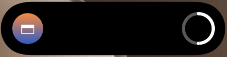
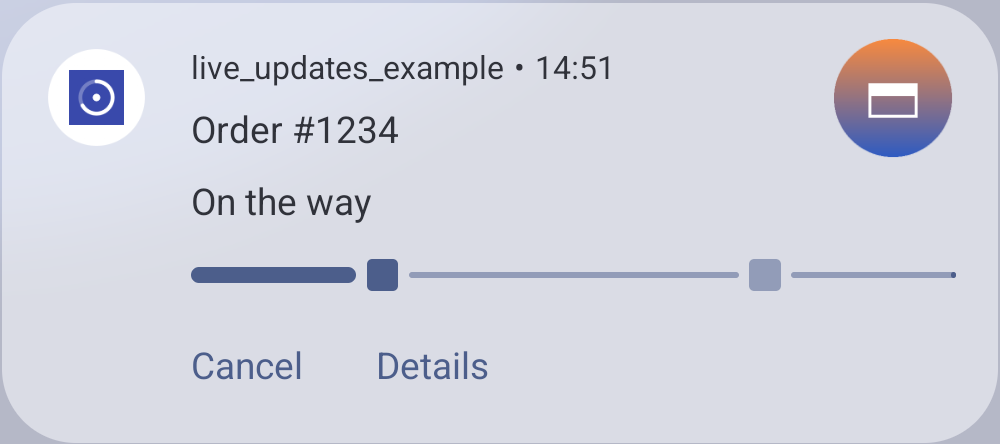
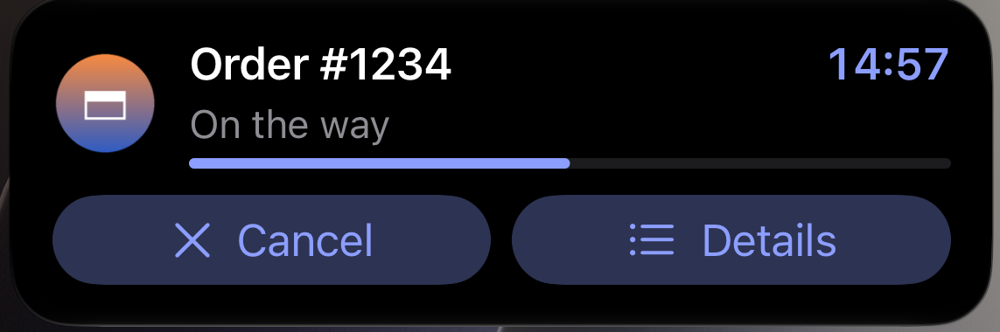
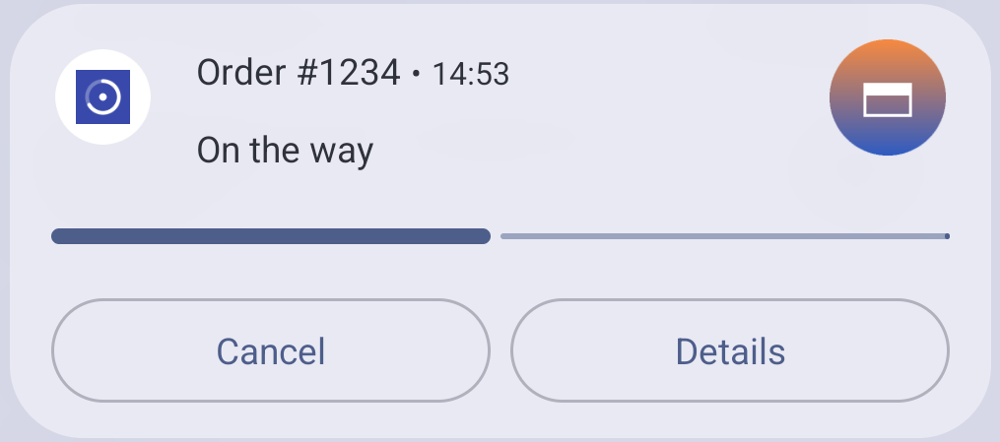
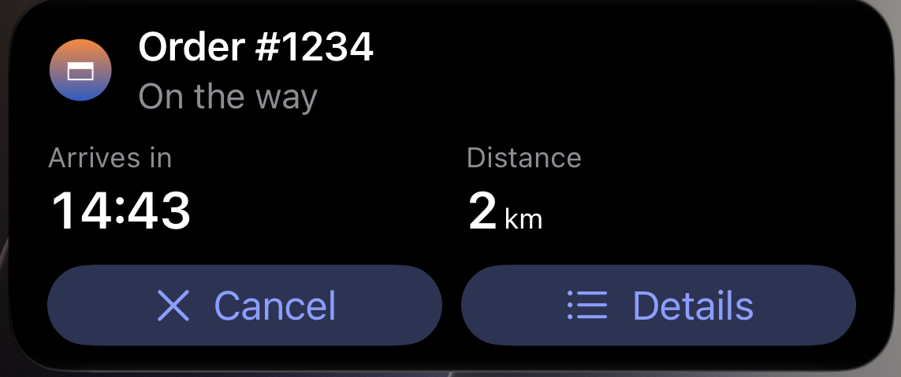
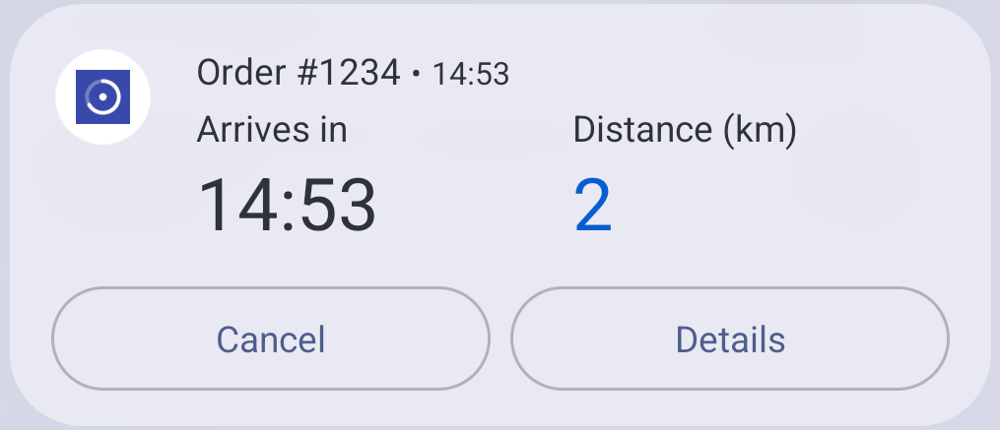
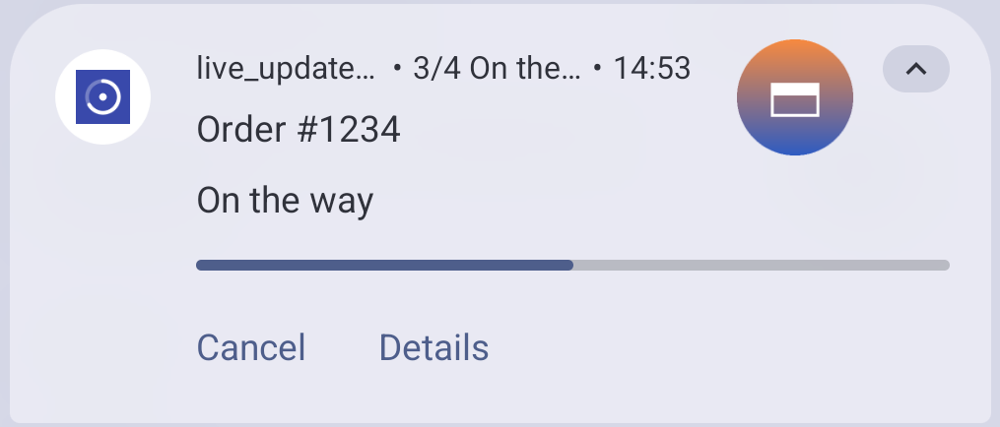
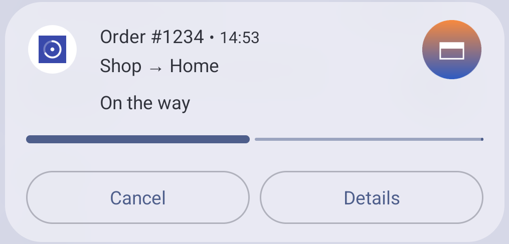

# live_updates

iOS **Live Activities** and Android **Live Update** notifications with one Dart API.

- One API to start, update and end a live update: title, body, progress, a system-counted timer, an image, buttons and a tap route.
- Five built-in iOS layouts (standard, timer, metrics, stepper, journey), chosen per update; Android shows the same content as progress stages, metrics or text.
- iOS 17.2+: ActivityKit Live Activities on the Lock Screen and in the Dynamic Island, with a ready-made SwiftUI widget you generate and customize.
- Android: ongoing notifications that Android 16 renders with `ProgressStyle` and, on builds that support promoted notifications (Android 16 QPR1 and later), promotes to Live Updates with a status bar chip. Older Android versions show a regular ongoing notification with a progress bar.
- Remote updates: iOS push-to-start and per-activity push tokens as streams; Android updates from a received payload (FCM glue lives in [`live_updates_fcm`](https://pub.dev/packages/live_updates_fcm)).
- No platform channels: native code is called through [FFIgen](https://pub.dev/packages/ffigen) (iOS) and [JNIgen](https://pub.dev/packages/jnigen) (Android). Runtime dependencies are only Dart and Flutter team packages (`ffi`, `objective_c`, `jni`, `crypto`, `meta`).
- Other platforms are a safe no-op.

> **Status:** 0.1.x. Breaking changes come with a new minor version (0.2.0); pin the version you test with.

| iOS Lock Screen | iOS Dynamic Island |
| --- | --- |
|  |  |
| **Android 16** | **Android 17** |
|  |  |

Screenshots of the example app in this repository.

## Platform support

| | iOS | Android 16+ | Android 7–15 | Other |
| --- | --- | --- | --- | --- |
| Start / update / end | Live Activity | Live Update (when promoted) | Ongoing notification | no-op |
| Progress | ✓ | `ProgressStyle` (segments, points) | progress bar | |
| Timer (countdown, stopwatch) | ✓ | chronometer | chronometer | |
| Metrics | `metrics` layout | Android 17 `MetricStyle`, else text | text | |
| Steps, journey | `stepper`, `journey` layouts | progress segments and points, text | progress bar, text | |
| Semantic colors | – | Android 17+ | – | |
| Buttons (`actions`) | ✓ | ✓ | ✓ | |
| Image | ✓ | large icon (not with Android 17 metrics) | large icon | |
| Tap route (`onTap`) | ✓ | ✓ | ✓ | |
| Lifecycle events (`states`, `onStarted`) | ✓ | ✓ | ✓ | |
| Live Activity push tokens | ✓ | – (FCM via `live_updates_fcm`) | – (FCM via `live_updates_fcm`) | |
| Remote updates | push to the system (APNs, or FCM), no app code | data message → `handleRemotePayload` | data message → `handleRemotePayload` | |
| One push to many devices | broadcast channels (iOS 18+) | FCM topics | FCM topics | |

Requirements: Flutter 3.50+, iOS 17.2+, Android 7.0 (API 24)+. Promotion to
a Live Update needs Android 16 QPR1 or later; the "Android 16+" column
otherwise describes an ongoing notification with those features.

## Getting started

```bash
flutter pub add live_updates
```

### iOS

1. Generate the widget extension from your app's root directory:

   ```bash
   dart run live_updates:create_widget
   ```

   This writes `ios/LiveUpdatesWidget/`, adds a *LiveUpdatesWidget* extension
   target to `Runner.xcodeproj` (using the `xcodeproj` Ruby gem that ships with
   CocoaPods), sets `NSSupportsLiveActivities` and registers the
   `liveupdates-<bundle id>` URL scheme used for taps. Use `--no-xcode` to only
   write the files and add the target yourself (File > New > Target > Widget
   Extension, deployment target 17.2).

   Flavors are supported: every build configuration (for example
   `Debug-dev`, `Release-prod`) gets a widget bundle id and an App Group
   derived from that configuration's app bundle id (`LIVE_UPDATES_APP_GROUP`
   build setting). If the bundle id is defined in an `.xcconfig` instead of
   the project, pass `--app-group group.<bundle id>`.

   The command needs Ruby with the `xcodeproj` gem (included with
   CocoaPods). If it is missing, the command offers to run
   `gem install --user-install xcodeproj` for you.

2. Open the project in Xcode once and select a signing team for the new target.

3. For push updates, add the **Push Notifications** capability to the Runner
   target.

#### Manual setup

With `--no-xcode` only the widget sources are written. Then, in Xcode:

1. File > New > Target > Widget Extension named `LiveUpdatesWidget`
   (no Live Activity or configuration intent templates), deployment target
   17.2, and replace its generated Swift files with the files from
   `ios/LiveUpdatesWidget/`.
2. Add `LiveUpdatesActionIntent.swift` to both the Runner and the widget
   target (Target Membership).
3. Runner `Info.plist`: add `NSSupportsLiveActivities` = YES and a URL type
   with the scheme `liveupdates-$(PRODUCT_BUNDLE_IDENTIFIER)`.
4. For images: add the App Groups capability with the same group to both
   targets and set `LiveUpdatesAppGroup` to that group in both Info.plist
   files.

#### Customizing the widget

`create_widget` writes two kinds of files to `ios/LiveUpdatesWidget/`:

- **Yours to edit**: `LiveUpdatesWidgetLiveActivity.swift` (the layout of the
  Lock Screen and every Dynamic Island presentation), the widget bundle and
  `Info.plist`. Running `create_widget` again keeps them; `--force` replaces
  them.
- **Owned by the plugin**: `LiveUpdatesAttributes.swift`,
  `LiveUpdatesViews.swift` (the building blocks the layout uses, such as
  `LiveUpdatesLockScreen` and `LiveUpdatesCompactTrailing`) and
  `LiveUpdatesActionIntent.swift`. Running `create_widget` again replaces
  them, so run it after updating live_updates. Do not edit them: copy a view
  into your layout file to change it.

In the layout, `context.state` has every field of `LiveUpdateContent`, and
`context.state.extra["driver"]` reads `IosLiveUpdateOptions.extra`, for
values the template does not show.

Without touching Swift, choose what the small Dynamic Island areas show:

```dart
ios: const IosLiveUpdateOptions(
  extra: {'gate': 'B12'},
  compactTrailing: IosIslandContent.extra('gate'), // or progress, timer, title, body
  minimal: IosIslandContent.timer,                  // or progress, icon, ...
),
```

Colors work the same way: `IosLiveUpdateOptions(color: ..., backgroundColor:
..., foregroundColor: ...)` sets the accent (progress, buttons, timer, Dynamic
Island keyline), the Lock Screen background and its text color, like
`AndroidLiveUpdateOptions.color` on Android. By default the Lock Screen card
is white in Light Mode and black in Dark Mode, and the Dynamic Island is
always black, so choose an accent that reads well on both. With a custom
background, set the text color too, for example `backgroundColor:
Colors.white, foregroundColor: Colors.black`. While the Always-On display dims
the Lock Screen, the system colors are used.

Content that is missing (such as `progress` without a progress) falls back to
the default, and text is left out when the island is limited in width (iOS 27,
for example in landscape). These options need a layout that uses `LiveUpdatesCompactTrailing`
and `LiveUpdatesMinimal`, as generated now: a layout generated by an older
version ignores them until you run `create_widget --force` or switch to those
views.

### Android

Nothing to configure. The plugin declares `POST_NOTIFICATIONS` and
`POST_PROMOTED_NOTIFICATIONS`. Call `LiveUpdates.requestPermission()` before
starting on Android 13+.

Android only promotes a notification to a Live Update when the build supports
it, the user allows it (`LiveUpdates.canPostPromotedNotifications()`), and the
notification meets the system's criteria. Otherwise it stays a regular
ongoing notification.

## Platform guidelines

Both platforms limit what these surfaces are for. Follow Apple's Human
Interface Guidelines for Live Activities and Android's
[Live Update guidance](https://developer.android.com/develop/ui/views/notifications/live-update):

- Use them for ongoing, user-initiated, time-sensitive activities, such as a
  ride, a food order, navigation, a call or a sports score.
- Do not use them for ads, promotions, chat messages, alerts, upcoming
  calendar events or quick access to app features.
- Do not start them for something the user did not ask for. On Android set
  `AndroidLiveUpdateOptions(mode: AndroidLiveUpdateMode.ongoing)` (or
  `classic`) for anything that is not a Live Update; it then stays a regular
  notification.
- Do not bring back an update the user dismissed. On Android `update` fails
  for a dismissed update, and remote `update` payloads for it are ignored.
- Keep `shortCriticalText` short (Android suggests at most 7 characters) and
  metric labels to 10 characters or fewer.

## Usage

```dart
import 'package:live_updates/live_updates.dart';

if (await LiveUpdates.requestPermission()) {
  final update = await LiveUpdates.start(
    const LiveUpdateContent(
      title: 'Order #1234',
      body: 'Preparing',
      progress: 0.1,
      route: '/orders/1234',
      android: AndroidLiveUpdateOptions(shortCriticalText: '10 min'),
    ),
  );

  await update.update(
    const LiveUpdateContent(title: 'Order #1234', body: 'On the way', progress: 0.6),
  );

  // iOS keeps the last content on the Lock Screen for 5 minutes. Android
  // removes the notification now, unless you pass finalContent: then that
  // content stays as a regular notification for the duration (Android 8.0+;
  // on Android 7 until the user dismisses it).
  await update.end(dismissAfter: const Duration(minutes: 5));
}

// Taps on a live update deliver its route. Only routes that one of the
// app's live updates carries are delivered, but treat them like any deep
// link: validate before acting on them.
LiveUpdates.onTap.listen((route) => router.go(route));

// Live updates still running, e.g. after an app restart.
final running = await LiveUpdates.active();

// Live updates that appear while the app runs, including remote starts.
LiveUpdates.onStarted.listen((update) => track(update));

// Lifecycle: stale (iOS), ended, dismissed (e.g. swiped away on Android).
update.states.listen((state) => print(state));

await LiveUpdates.endAll();
```

### One live update per key

When your data already has an id, use it as the key. Calling
`startOrUpdate` again updates the same live update instead of starting a
duplicate, and `find` gets it back after an app restart:

```dart
await LiveUpdates.startOrUpdate('order-1234', content);
final update = await LiveUpdates.find('order-1234');
```

On Android the key is the update's id and is the same as `live_updates_id`
in remote payloads, so the app and the server address the same notification.
On iOS the key is stored in the activity's attributes; a push-to-start can set
it with `"attributes": {"key": "order-1234"}`.

### Buttons

```dart
const LiveUpdateContent(
  title: 'Order #1234',
  actions: [
    LiveUpdateAction(
      id: 'cancel',
      title: 'Cancel',
      iosSystemImage: 'xmark',
      requiresUnlock: true,
    ),
    LiveUpdateAction(id: 'track', title: 'Track', opensApp: true),
  ],
);

LiveUpdates.onAction.listen((event) {
  // event.updateId, event.actionId
});
```

- Buttons without `opensApp` run in the background: on iOS through
  `LiveUpdatesActionIntent` (a `LiveActivityIntent` that `create_widget`
  compiles into both the app and the widget), on Android through a broadcast
  receiver. The press is delivered to `onAction` while the app is in the
  foreground. Otherwise it runs the background handler (below), or, without
  one, it is queued and delivered once the app listens in the foreground;
  use `opensApp: true` when the press must open the app.
- `opensApp: true` opens the app and delivers the press to `onAction`. If no
  listener takes it within 5 seconds, the background handler runs it.
- `LiveUpdate.actions` receives only that update's presses; presses of other
  updates go to `onAction` or the background handler.
- Background presses work on the Lock Screen without unlocking the device.
  Set `requiresUnlock: true` on buttons with consequences, such as cancelling
  an order: iOS asks for Face ID or the passcode first, and Android 12+ asks
  the user to unlock.

#### Handling presses while the app is not running

Register a background handler to act on a press immediately, even when the
app is not running. The plugin starts a headless Flutter engine, runs the
handler and shuts the engine down:

```dart
@pragma('vm:entry-point')
Future<void> onBackgroundAction(LiveUpdateActionEvent event) async {
  if (event.actionId == 'cancel') {
    await api.cancelOrder(event.updateId);
    final updates = await LiveUpdates.active();
    await updates
        .where((u) => u.id == event.updateId)
        .firstOrNull
        ?.end(dismissAfter: Duration.zero);
  }
}

Future<void> main() async {
  WidgetsFlutterBinding.ensureInitialized();
  await LiveUpdates.setBackgroundActionHandler(onBackgroundAction);
  runApp(const App());
}
```

- The handler runs for every press while the app is in the background (the
  system keeps the app alive for it), and in the foreground for presses that
  no `onAction` (or that update's `LiveUpdate.actions`) listener takes.
- It must be a top-level or static function with
  `@pragma('vm:entry-point')`, and it has limited time (about 9 seconds on
  Android, 25 seconds on iOS).
- live_updates itself works in the handler. On iOS, other plugins that use
  platform channels need to be registered for the background engine:

  ```swift
  // AppDelegate.swift
  LiveUpdatesPlugin.setPluginRegistrantCallback { registry in
    GeneratedPluginRegistrant.register(with: registry)
  }
  ```

  On Android, plugins are registered automatically.
- Apps that set up the widget with an older version should run
  `dart run live_updates:create_widget` again to update
  `LiveUpdatesActionIntent.swift`.
- Android shows up to three actions. On iOS keep labels short: the whole
  content must stay under ActivityKit's 4 KB limit.

### Timers

A countdown or a stopwatch keeps running between updates because the system
counts it: iOS draws it in the widget template, Android shows the
notification's chronometer. Use it instead of updating a text every second,
which uses up the update budget.

```dart
LiveUpdateContent(
  title: 'Order #1234',
  timer: LiveUpdateTimer.countdown(eta), // or LiveUpdateTimer.stopwatch(startedAt)
);
```

On iOS a countdown stops at zero; Android keeps counting below zero, so update
or end the live update when the time is up.

### Layouts

Describe what the update is about, then choose how the iOS Lock Screen shows
it with `IosLiveUpdateOptions.layout`. The data is shared: Android uses the
same fields in its own way, so one content serves both platforms.

```dart
LiveUpdateContent(
  title: 'Order #1234',
  body: 'On the way',
  progress: 0.6,
  timer: LiveUpdateTimer.countdown(eta),
  metrics: [
    LiveUpdateMetric.timer('Arrives in', eta),
    LiveUpdateMetric.decimal('Distance', 1.2, unit: 'km'),
  ],
  steps: const LiveUpdateSteps(
    ['Ordered', 'Preparing', 'On the way', 'Delivered'],
    current: 2,
  ),
  journey: const LiveUpdateJourney(from: 'Shop', to: 'Home', toDetail: '18:30'),
  ios: const IosLiveUpdateOptions(layout: IosLiveUpdateLayout.stepper),
);
```

| Layout | iOS Lock Screen | Data | Android |
| --- | --- | --- | --- |
| `standard` (default) | image, title, body, progress bar | `progress` | progress bar |
| `timer` | a large countdown or stopwatch | `timer` | chronometer |
| `metrics` | up to three labeled values | `metrics` | Android 17 `MetricStyle`; older versions add number and text metrics to the text |
| `stepper` | stages as dots, the current one highlighted | `steps` | Android 16+ progress segments and points; "2/4 Preparing" in the text |
| `journey` | from and to with the progress between them | `journey`, `progress` | "Shop → Home" in the text |

The same content on each platform (the example app; iOS 27 Lock Screen,
Android 17 notification shade):

| Layout | iOS | Android Live Update | Android ongoing notification |
| --- | --- | --- | --- |
| `standard` |  |  |  |
| `timer` |  |  |  |
| `metrics` |  |  |  |
| `stepper` |  |  |  |
| `journey` |  |  |  |

Android has no layout setting; it shows the data that the content carries.
The Live Update column is `AndroidLiveUpdateMode.liveUpdate` on builds that
support promoted notifications (Android 16 QPR1 and later); metrics use
`MetricStyle` only on Android 17. The ongoing notification column is
`AndroidLiveUpdateMode.classic`, which is also what Android 15 and earlier
show.

A layout whose data is missing falls back to `standard`. The expanded Dynamic
Island shows the metrics, steps or journey of the chosen layout in place of
the body (there is no room for both), and buttons stay at the bottom of every
layout. The layout can change with each update.

For a layout of your own, pass `IosLiveUpdateLayout.custom('name')` and add a
case to the switch in `LiveUpdatesWidgetLiveActivity.swift`:

```swift
switch context.state.layout {
case "name": MyLayout(state: context.state)
default: LiveUpdatesLockScreen(state: context.state, activityID: context.activityID)
}
```

Run `dart run live_updates:create_widget` after updating live_updates to get
the built-in layouts (it updates `LiveUpdatesViews.swift` and keeps your
layout file). A layout file generated by an older version has no switch; add
it yourself, or regenerate the file with `--force` after copying your changes.

### Android display modes

`AndroidLiveUpdateOptions.mode` chooses how Android 16 and later show the
update (older versions always show a regular ongoing notification with a
progress bar):

| Mode | Android 16+ look | Promoted to a Live Update |
| --- | --- | --- |
| `liveUpdate` (default) | `ProgressStyle` / Android 17 `MetricStyle` | requested |
| `ongoing` | `ProgressStyle` / Android 17 `MetricStyle` | no |
| `classic` | the same as Android 15 and earlier | no |

Use `liveUpdate` only for activities that fit Android's Live Update guidance,
`ongoing` for other activities that benefit from the richer progress, and
`classic` for the same look on every version (the body is always shown,
metrics are added to the text, and segments, points and semantic colors are
not used).

### Android progress stages, timeout and alerts

```dart
LiveUpdateContent(
  title: 'Order #1234',
  progress: 0.6,
  android: const AndroidLiveUpdateOptions(
    // Android 16+: preparing, on the way, delivered (relative lengths).
    progressSegments: [
      AndroidProgressSegment(1),
      AndroidProgressSegment(2),
      AndroidProgressSegment(1),
    ],
    progressPoints: [AndroidProgressPoint(.25), AndroidProgressPoint(.75)],
    progressTrackerIcon: 'ic_courier', // a drawable in your app
    // Removed after 2 hours even if the app never ends it.
    timeoutAfter: Duration(hours: 2),
    // Sound and vibrate for this post (normally only the first one alerts).
    alert: true,
  ),
);
```

`progress` still runs from 0 to 1 over the whole bar, and the segments,
points and tracker icon need it (or `steps`). Explicit segments and points take
precedence over those made from `steps`. On Android 17 `metrics` replace the
progress bar; below Android 16 the segments, points and tracker icon are ignored. The
timeout counts from the latest post, and requested alerts are limited to one
per update every 10 seconds. The iOS equivalent of `alert`
is `IosLiveUpdateOptions.alert`.

### Android 17 metrics and semantic colors

On Android 17 a Live Update with `metrics` (see [Layouts](#layouts)) shows
them with `MetricStyle` instead of the progress bar. Timers and stopwatches
are counted by the system, so they keep running between updates.
`criticalMetric` picks the one that may appear in the status bar chip.
Semantic styles let Android color the body text, the progress bar or a metric
by meaning (info, safe, caution, danger); the system picks the colors and
applies them to promoted Live Updates.

While metrics are set, Android 17 does not show the body text (its metric
template has no room for it), so put anything users must read in the title or
in a `LiveUpdateMetric.text`. Below Android 17 the number and text metrics
are added to the notification text, and semantic styles are ignored. The same
keys work in remote payloads (see
[docs/testing-remote.md](https://github.com/metal-president/live_updates/blob/main/docs/testing-remote.md)).

### Images

Pass a picture with the content. It becomes the thumbnail in the iOS widget
template (Lock Screen and Dynamic Island) and the large icon of the Android
notification (Android 17 does not show it with `metrics`):

```dart
const LiveUpdateContent(
  title: 'Courier on the way',
  image: LiveUpdateImage.asset('assets/courier.png'),
  // or LiveUpdateImage.file(path), .memory(bytes), .network(Uri.parse(url))
);
```

Images are scaled to `maxDimension` pixels (default 256), stored as PNG and
reused when identical; files unused for a day are cleaned up.

On iOS the widget extension cannot read the app's files, so images go through
an App Group. `create_widget` sets one up by default (`group.<app bundle id>`,
or `--app-group <id>`): it adds the entitlement to both targets and writes the
`LiveUpdatesAppGroup` Info.plist key the plugin and the widget read. With
automatic signing Xcode registers the group; otherwise add it in your Apple
Developer account. A customized widget loads an image with
`LiveUpdatesImages.url(context.state.image)`.

### Icons

`iconName` names a drawable (or mipmap) on Android and an image in the widget
extension's asset catalog on iOS. Without it, the app icon (Android) or a
system symbol (iOS widget template) is used.

## Remote updates

The content JSON is the same on both platforms; only the push envelope
differs. To reach both through FCM from one server, see
[docs/server-fcm.md](https://github.com/metal-president/live_updates/blob/main/docs/server-fcm.md). `LiveUpdate.key` is the id your server uses for an
update on both platforms.

### iOS (APNs)

```dart
// Start activities from your server (iOS 17.2+).
LiveUpdates.pushToStartTokens.listen((token) => api.registerPushToStart(token.hex));

// Update a running activity from your server.
final update = await LiveUpdates.start(
  const LiveUpdateContent(title: 'Order #1234'),
  pushUpdates: true,
);
update.pushTokens.listen((token) => api.registerActivity(update.id, token.hex));
```

Send pushes with `apns-push-type: liveactivity` and topic
`<bundle id>.push-type.liveactivity`. The `content-state` uses the same keys as
`LiveUpdateContent` (`title` is required): `title`, `body`, `progress`,
`iconName`, `route`, `actions`, `extra`, `timerStart` / `timerEnd`
(seconds since 1970), the island options `compactTrailing` / `minimal` and the
colors `tintArgb` / `backgroundArgb` / `foregroundArgb` (ARGB integers).
For push-to-start, set `"attributes-type": "LiveUpdatesAttributes"`,
`"attributes": {"key": "<your id>"}` (or `{}` without a key) and an `alert`.
[docs/server-fcm.md](https://github.com/metal-president/live_updates/blob/main/docs/server-fcm.md)
has complete payloads.

### iOS broadcast (iOS 18+)

For updates that many users share, such as a match score, subscribe the
activity to an APNs broadcast channel instead of collecting per-activity
tokens. One push to the channel updates every subscribed device.

```dart
final update = await LiveUpdates.start(
  const LiveUpdateContent(title: 'Home 2 - 1 Away', body: '78 min'),
  iosChannelId: channelIdFromYourServer,
);
```

- Enable **Broadcast Capability** for the App ID in your Apple Developer
  account (Identifiers > Push Notifications); Xcode cannot enable it.
- Your server creates channels with APNs' channel management API and sends
  `update` / `end` pushes to them; `tool/send_push.dart apns-channel` and
  `apns-broadcast` show both requests.
- Broadcasts cannot start activities. Start locally with `iosChannelId`, or
  send a push-to-start with `input-push-channel` so the started activity
  joins the channel.
- `iosChannelId` cannot be combined with `pushUpdates`, and throws a
  `LiveUpdateException` before iOS 18. On Android, use FCM topic messages
  with the payload below.

### Android

Deliver a data message and pass it to `LiveUpdates.handleRemotePayload`:

| Key | Value |
| --- | --- |
| `live_updates_event` | `start`, `update` or `end` |
| `live_updates_id` | Your id for the update (used by later messages) |
| `live_updates_content` | Content as a JSON string, same keys as above |
| `live_updates_dismiss_after` | Optional, seconds to keep final content on `end` (without it, it stays until dismissed) |

With Firebase, [`live_updates_fcm`](https://pub.dev/packages/live_updates_fcm)
does this for you.

See [docs/testing-remote.md](https://github.com/metal-president/live_updates/blob/main/docs/testing-remote.md)
for a step-by-step verification guide and `tool/send_push.dart` for a sender.

## How it works

- **iOS:** a small `@objc` Swift class (`LiveUpdatesBridge`) wraps ActivityKit
  for one fixed `ActivityAttributes` type, `LiveUpdatesAttributes`. Dart calls
  it through FFIgen-generated Objective-C bindings.
- **Android:** a Java class (`LiveUpdatesBridge`) builds the notifications.
  Dart calls it through JNIgen-generated bindings.

## License

MIT
