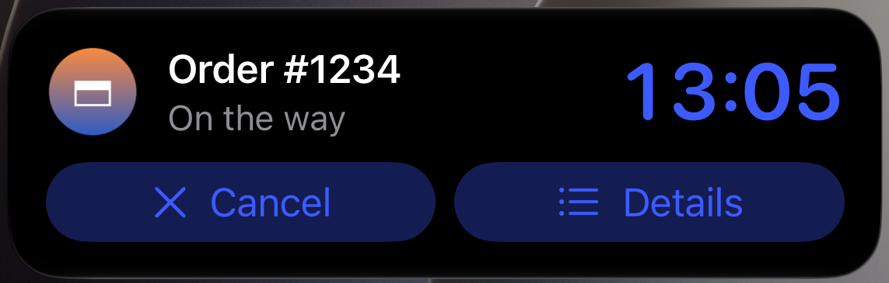
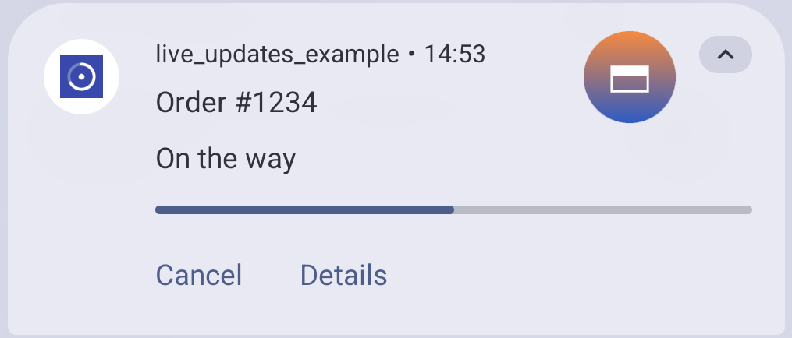
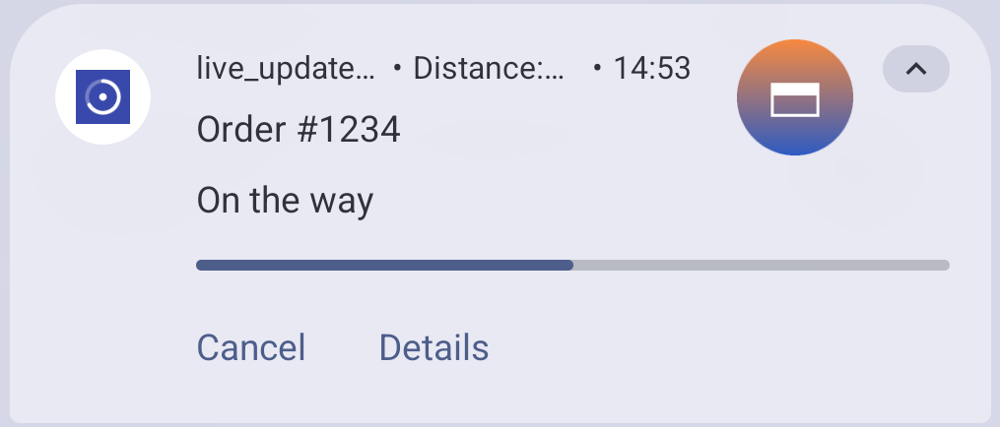
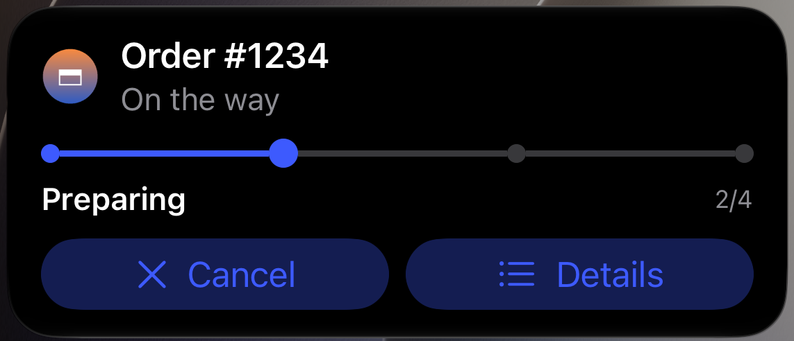
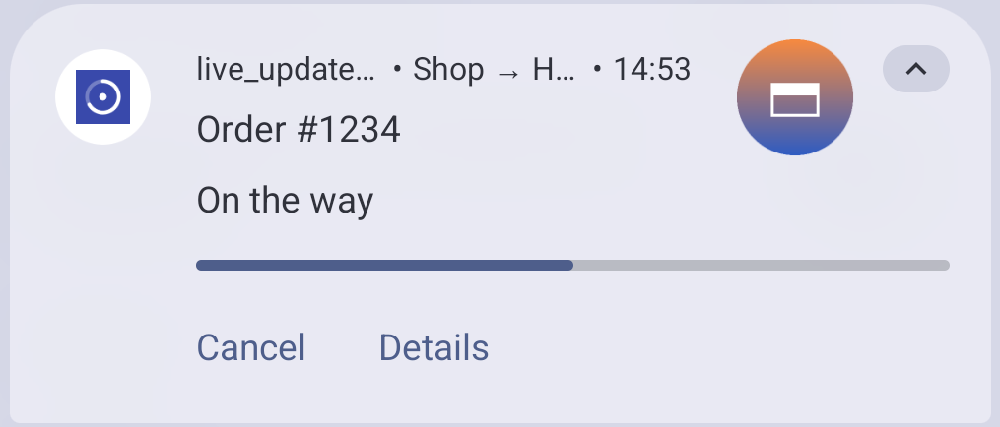
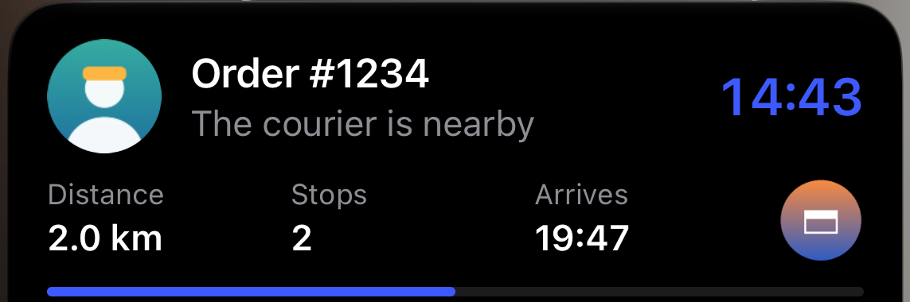
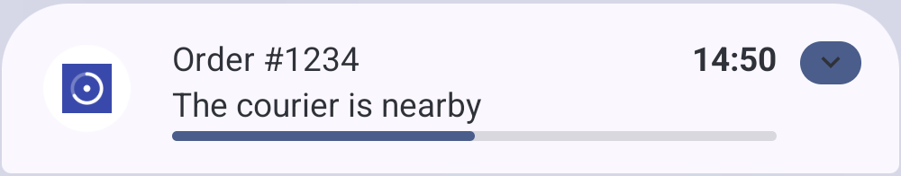
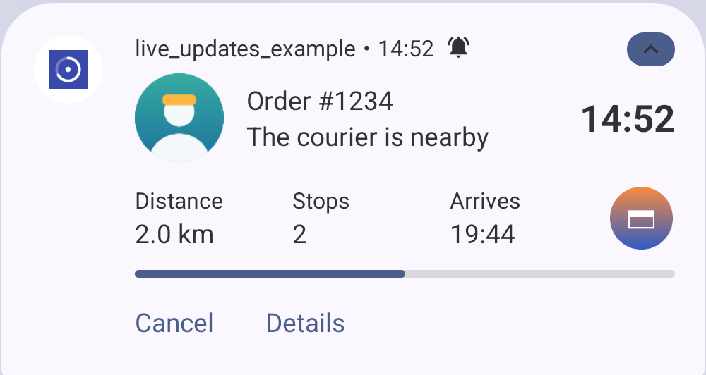

# live_updates

iOS **Live Activities** and Android **Live Update** notifications with one Dart API.
In this README, a *live update* is either of them.

| iOS Lock Screen | iOS Dynamic Island |
| --- | --- |
|  |  |
| **Android 16** | **Android 17** |
|  |  |

Screenshots of the example app in this repository. See also the
[built-in layouts](#layouts) and a [custom layout](#custom-layouts).

- **One API for both platforms:** start, update and end with a title, body,
  progress, a system-counted timer, an image, buttons and a tap route.
- **Scheduling and ending at a time:** show a live update later, even if
  the app is not running then (iOS 26+ and Android), and switch it to ended
  content such as "Delivered" at a set time ([Scheduling](#scheduling),
  [Ending at a time](#ending-at-a-time)).
- **iOS 16.2+:** Lock Screen and Dynamic Island, with five built-in
  [layouts](#layouts) (standard, timer, metrics, stepper, journey) and a
  SwiftUI widget you generate with one command and can customize.
- **Android:** `ProgressStyle` notifications on Android 16+, promoted to a
  Live Update with a status bar chip when the system allows it (Android 16
  QPR1 and later), and an ongoing notification with a progress bar on older
  versions.
- **[Custom layouts](#custom-layouts):** draw the iOS widget in SwiftUI and
  the Android notification with XML layouts of your own (Android shows them
  as an ongoing notification), both filled from the same content.
- **[Remote updates](#remote-updates):** start, update and end from your
  server (APNs on iOS, a data message on Android; optional FCM helper:
  [`live_updates_fcm`](https://pub.dev/packages/live_updates_fcm)).
- **Lightweight:** no platform channels (native code is called through
  [FFIgen](https://pub.dev/packages/ffigen) and
  [JNIgen](https://pub.dev/packages/jnigen)), and runtime dependencies are only
  Dart and Flutter team packages (`ffi`, `objective_c`, `jni`, `crypto`,
  `meta`). Other platforms are a safe no-op.

> **Status:** 0.5.x. Breaking changes come with a new minor version (0.6.0).

## Contents

- [Platform support](#platform-support)
- [Getting started](#getting-started)
- [Platform guidelines](#platform-guidelines)
- [Permissions and settings](#permissions-and-settings)
- [Usage](#usage)
  - [Start, update and end](#start-update-and-end)
  - [Taps and running updates](#taps-and-running-updates)
  - [When the app is closed](#when-the-app-is-closed)
  - [One live update per key](#one-live-update-per-key)
  - [Layouts](#layouts)
  - [Timers](#timers)
  - [Images](#images)
  - [Icons](#icons)
  - [Buttons](#buttons)
  - [Alerts](#alerts)
  - [Hiding content on the Lock Screen](#hiding-content-on-the-lock-screen)
  - [Scheduling](#scheduling)
  - [Ending at a time](#ending-at-a-time)
- [Platform-specific options](#platform-specific-options)
  - [Colors and the Dynamic Island](#colors-and-the-dynamic-island)
  - [Android display modes](#android-display-modes)
  - [Android progress stages and timeout](#android-progress-stages-and-timeout)
  - [Android 17 metrics and semantic colors](#android-17-metrics-and-semantic-colors)
- [Custom layouts](#custom-layouts)
  - [Customizing the iOS widget](#customizing-the-ios-widget)
  - [Customizing the Android notification](#customizing-the-android-notification)
- [Previewing and troubleshooting](#previewing-and-troubleshooting)
  - [Check on a simulator or emulator](#check-on-a-simulator-or-emulator)
  - [Xcode previews](#xcode-previews)
  - [Android Studio layout preview](#android-studio-layout-preview)
  - [Check content in tests](#check-content-in-tests)
  - [Diagnose the setup](#diagnose-the-setup)
- [Platform limits](#platform-limits)
- [Remote updates](#remote-updates)
- [Upgrading](#upgrading)
- [How it works](#how-it-works)

## Platform support

**Requirements:** Flutter 3.50+, iOS 15.0+, Android 7.0 (API 24)+, and
Xcode 26+ to build (the plugin builds against iOS 26 APIs). Live Activities
need iOS 16.2: on iOS 15.0 to 16.1 every call does nothing and
`isSupported()` returns `false`, as it does on iOS 16 when the app's widget
extension targets a newer iOS. Some features need a newer iOS: buttons need
iOS 17.0 (before that none are shown; a tap on the activity still opens the
app with its route), and push-to-start needs iOS 17.2.

| | iOS 16.2+ | Android 16+ | Android 7–15 | iOS 15.0–16.1, other |
| --- | --- | --- | --- | --- |
| Start / update / end | Live Activity | Live Update (when promoted) | Ongoing notification | no-op |
| Progress, timer, image | ✓ | ✓ (`ProgressStyle`) | ✓ | |
| [Layouts](#layouts) (metrics, steps, journey) | five layouts | Android 16 progress segments and points, Android 17 `MetricStyle`, else text | progress bar, text | |
| Buttons (`actions`) | iOS 17+ | ✓ | ✓ | |
| [Custom layout](#custom-layouts) | SwiftUI | XML layout (not promoted) | XML layout | |
| Scheduled start (`schedule`) | iOS 26+ | ✓ (alarm) | ✓ (alarm) | |
| Ended content at a time (`endAt`) | ✓ (stale date) | ✓ (alarm) | ✓ (alarm) | |
| [Remote updates](#remote-updates) | APNs or FCM (push-to-start iOS 17.2+), no app code | data message → `handleRemotePayload` (FCM: `live_updates_fcm`) | data message → `handleRemotePayload` (FCM: `live_updates_fcm`) | |
| One push to many devices | broadcast channels (iOS 18+) | FCM topics | FCM topics | |

Taps (`onTap`) and lifecycle events (`states`, `onStarted`) work wherever
live updates do.

## Getting started

```bash
flutter pub add live_updates
```

### iOS

1. From your app's root directory, generate the widget extension:

   ```bash
   dart run live_updates:create ios
   ```

   This writes `ios/LiveUpdatesWidget/`, adds a *LiveUpdatesWidget* extension
   target (iOS 16.2) to `Runner.xcodeproj`, sets `NSSupportsLiveActivities`,
   and sets up the URL scheme for taps (`liveupdates-<bundle id>`) and the App
   Group for [images](#images). It needs Ruby with the `xcodeproj` gem
   (included with CocoaPods) and offers to run
   `gem install --user-install xcodeproj` if it is missing.

   - **Deployment target:** only the widget extension needs iOS 16.2; the
     app can target iOS 15.0 or later.
   - **Flavors:** every build configuration (for example `Debug-dev`,
     `Release-prod`) gets a widget bundle id and an App Group derived from
     its app bundle id (`LIVE_UPDATES_APP_GROUP` build setting). If the bundle
     id is set in an `.xcconfig` instead of the project, pass
     `--app-group group.<bundle id>`.
   - **Manual setup:** pass `--no-xcode` to only write the files, then follow
     [Manual setup](#manual-setup).

2. Open the project in Xcode once and select a signing team for the new target.

3. For push updates, add the **Push Notifications** capability to the Runner
   target.

The generated widget works as is. To change how it looks (optional), see
[Customizing the iOS widget](#customizing-the-ios-widget).

#### Manual setup

With `--no-xcode` only the widget sources are written. Then, in Xcode:

1. File > New > Target > Widget Extension named `LiveUpdatesWidget`
   (no Live Activity or configuration intent templates), deployment target
   16.2, and replace its generated Swift files with the files from
   `ios/LiveUpdatesWidget/`.
2. Add `LiveUpdatesActionIntent.swift` to both the Runner and the widget
   target (Target Membership).
3. Runner `Info.plist`: add `NSSupportsLiveActivities` = YES and a URL type
   with the scheme `liveupdates-$(PRODUCT_BUNDLE_IDENTIFIER)`.
4. For images: add the App Groups capability with the same group to both
   targets and set `LiveUpdatesAppGroup` to that group in both Info.plist
   files.
5. In the widget's `Info.plist`, add `LiveUpdatesWidget` as a Boolean set to
   YES, so the plugin checks that this extension supports the running iOS.
6. In the Runner target, move the *Embed Foundation Extensions* build phase
   above *Thin Binary*; otherwise Flutter builds fail with a build cycle.
7. In the project's Info tab, under Configurations, give each build
   configuration of the widget target the same base configuration file
   (`.xcconfig`) as Runner. Then, in the widget target's Build Settings, set
   `MARKETING_VERSION` to `$(FLUTTER_BUILD_NAME)` and
   `CURRENT_PROJECT_VERSION` to `$(FLUTTER_BUILD_NUMBER)`. App extensions
   must have the same version and build number as their app
   ([source][ios-version-numbers]).

### Android

No native setup is required. Call `LiveUpdates.requestPermission()` before
starting (see [Permissions and settings](#permissions-and-settings)). Also add
a single-color status bar icon and make it the default icon (see
[Icons](#icons)); without one, Android shows the app icon as a solid shape.

The plugin declares these permissions:

- `POST_NOTIFICATIONS`: the notification permission (see
  [Permissions and settings](#permissions-and-settings)).
- `POST_PROMOTED_NOTIFICATIONS`: lets Android 16 QPR1 and later promote the
  notification to a Live Update when it meets the system's criteria (see
  [Platform limits](#platform-limits)). It is granted at install time without
  a prompt ([source][android-promoted-permission]).
- `RECEIVE_BOOT_COMPLETED`: lets the plugin set the alarms of
  [scheduled](#scheduling) live updates again after a reboot, which cancels
  all alarms ([source][android-alarms]).

You can remove the last two in `android/app/src/main/AndroidManifest.xml`:
`POST_PROMOTED_NOTIFICATIONS` if your app only uses
`AndroidLiveUpdateMode.ongoing` or `AndroidLiveUpdateMode.classic`, which never
ask for promotion, and `RECEIVE_BOOT_COMPLETED` if it never calls `schedule`
(see [Scheduling](#scheduling) for what changes without it).

```xml
<manifest xmlns:android="http://schemas.android.com/apk/res/android"
    xmlns:tools="http://schemas.android.com/tools">
  <uses-permission
      android:name="android.permission.POST_PROMOTED_NOTIFICATIONS"
      tools:node="remove" />
  <uses-permission
      android:name="android.permission.RECEIVE_BOOT_COMPLETED"
      tools:node="remove" />
  ...
</manifest>
```

To draw the notification with layouts of your own (optional), see
[Customizing the Android notification](#customizing-the-android-notification).

## Platform guidelines

Both platforms limit what these surfaces are for. Follow Apple's Human
Interface Guidelines for Live Activities and Android's
[Live Update guidance](https://developer.android.com/develop/ui/views/notifications/live-update):

- Use them for ongoing, user-initiated, time-sensitive activities, such as a
  ride, a food order, navigation, a call or a sports score.
- Do not use them for ads, promotions, chat messages, alerts, upcoming
  calendar events or quick access to app features.
- Do not start them for something the user did not ask for. On Android set
  `AndroidLiveUpdateOptions(mode: AndroidLiveUpdateMode.ongoing)` (or
  `classic`) for anything that is not a Live Update; it then stays a regular
  notification.
- Do not bring back an update the user dismissed, and use a new key for a
  new activity. On Android, `update` fails for a dismissed update, remote
  `update` payloads for it are ignored, and `startOrUpdate` does not show
  the key again until you `end` it. On iOS the plugin cannot always tell a
  dismissal from other ends (for example while the app is not running), so
  `startOrUpdate` can start the key again once the system no longer lists
  the dismissed activity. A remote `start` (or an iOS push-to-start) shows
  it again: send one only for a new activity.
- Keep `shortCriticalText` under 7 characters (see
  [Platform limits](#platform-limits)).

## Permissions and settings

The table lists what the user can allow or turn off, and how the app finds
out. Most apps
need only the first two rows: call `requestPermission()` before you start,
and offer `openSettings()` when a call fails with `disabled`.

| Setting | Platforms | Check | Ask or open | When it is off |
| --- | --- | --- | --- | --- |
| Notifications for the app (the `POST_NOTIFICATIONS` permission on Android 13+) | Android | `isSupported()` | `requestPermission()` (prompt on Android 13+), `openSettings()` | `start`, `startOrUpdate` and `update` throw a `LiveUpdateException` (`disabled`), as do `schedule` and `reschedule` with a past time; remote starts and schedules that come due show nothing ([source][android-permission]) |
| Live Activities for the app | iOS 16.2+ | `isSupported()` | `openSettings()`; `requestPermission()` only returns `isSupported()` | `start`, `startOrUpdate` and `schedule` throw a `LiveUpdateException` (`disabled`) ([source][ios-activitykit]); a schedule made before still starts (see [Scheduling](#scheduling)) |
| The notification channel | Android 8.0+ | none | `openSettings()` | `start`, `startOrUpdate` and `update` throw a `LiveUpdateException` (`disabled`), as do `schedule` and `reschedule` with a past time; schedules that come due show nothing ([source][android-channels]) |
| Live Update promotion (`POST_PROMOTED_NOTIFICATIONS`, granted at install) | Android 16 QPR1+ | `canPostPromotedNotifications()`, `LiveUpdate.isPromoted()` | none (see the promotion settings in [Platform limits](#platform-limits)) | a regular ongoing notification ([source][android-live-update]) |
| Exact alarms (`SCHEDULE_EXACT_ALARM`, declared by your app) | Android 12+ | `canScheduleExactly()` | `openExactAlarmSettings()` | scheduled updates appear within `AndroidScheduleOptions.window`, `endedContent` within 10 minutes ([source][android-alarms]) |
| Frequent updates (`NSSupportsLiveActivitiesFrequentUpdates` in the Runner `Info.plist`) | iOS | none | none | pushes with `apns-priority: 10` are limited to the hourly budget ([source][ios-push]) |

"none" means this plugin offers no call for it; the user changes the
setting in the system Settings app. `openSettings()` opens the app's page in
Settings on iOS ([source][ios-open-settings]), the app's notification
settings on Android 8.0 and later ([source][android-app-notification-settings]),
and the app's details below Android 8.0. `disabled` is the
[`reason`](#start-update-and-end) of the `LiveUpdateException`.

- **Settings change at any time,** and the plugin reports no event for it.
  Check again when the app returns to the foreground, for example with an
  `AppLifecycleListener`, before you show a "Track on Lock Screen" option.
- **Android prompt:** `requestPermission()` returns `false` without a prompt
  while no activity is attached (for example in a background handler; call
  it again from the foreground), when the user has denied the permission
  more than once ([source][android-permission-denial]), and when the
  permission is granted but notifications are turned off for the app. In
  the last two cases only Settings can turn notifications on
  (`openSettings()`).

## Usage

### Start, update and end

```dart
import 'package:live_updates/live_updates.dart';

Future<void> trackOrder() async {
  if (!await LiveUpdates.requestPermission()) return;

  final update = await LiveUpdates.start(
    const LiveUpdateContent(
      title: 'Order #1234',
      body: 'Preparing',
      progress: 0.1,
      route: '/orders/1234',
      android: AndroidLiveUpdateOptions(shortCriticalText: '10 min'),
    ),
  );

  await update.update(
    const LiveUpdateContent(title: 'Order #1234', body: 'On the way', progress: 0.6),
  );

  // Lifecycle: stale (at endAt), ended, dismissed (e.g. swiped away).
  update.states.listen((state) => print(state));

  // The last content stays for 5 minutes: on the iOS Lock Screen, and on
  // Android as a regular notification the user can swipe away. Without
  // dismissAfter it stays up to 4 hours; Duration.zero removes it now.
  await update.end(dismissAfter: const Duration(minutes: 5));
}
```

`LiveUpdates.start`, `startOrUpdate` and `schedule`, `LiveUpdate.update` and
`ScheduledLiveUpdate.reschedule` throw a `LiveUpdateException` when the
system refuses. Its `reason` (a `LiveUpdateFailure`) says why:

- `disabled`: the user turned live updates off (see
  [Permissions and settings](#permissions-and-settings)). Offer
  `LiveUpdates.openSettings()`.
- `limitReached`, `notInForeground`, `unsupported` (iOS only): too many
  activities, the app is in the background, or the device or iOS version
  does not support the call ([source][ios-authorization-error]).
- `other`: anything else; see `message`.

```dart
try {
  await LiveUpdates.start(const LiveUpdateContent(title: 'Order #1234'));
} on LiveUpdateException catch (e) {
  if (e.reason != LiveUpdateFailure.disabled) rethrow;
  await LiveUpdates.openSettings(); // check again when the app resumes
}
```

### Taps and running updates

```dart
// Taps on a live update deliver its route. Only routes that one of the
// app's live updates carries are delivered, but treat them like any deep
// link: validate before acting on them.
LiveUpdates.onTap.listen((route) => router.go(route));

// Live updates still running, e.g. after an app restart.
final running = await LiveUpdates.active();

// The current state, to set up your UI after a restart (null when gone):
// active, stale (past endAt), ended (still shown after end) or dismissed.
final state = await LiveUpdates.stateOf('order-1234'); // or update.state()

// Live updates that appear while the app runs, including remote starts.
LiveUpdates.onStarted.listen((update) => track(update));

await LiveUpdates.endAll();
```

### When the app is closed

Live updates keep showing after the user closes the app, for example by
swiping it away in the app switcher: that is what they are for, and remote
updates keep them current. The plugin does not end them then, because
neither platform tells an app reliably that it is being closed. iOS calls
`applicationWillTerminate` only when the app is not suspended
([source][ios-will-terminate]), and Android reports a removed task only to a
running service ([source][android-task-removed]), which the system stops in
the background ([source][android-background-limits]).

To make sure updates do not outlive their purpose, use what always works:

- **At the next start**, end what the previous session left, for example
  when your app only shows updates while it is in use:

  ```dart
  await LiveUpdates.endAll();
  ```

- **By time:** `endAt` with `endedContent`, a countdown (removed on Android
  when it ends), `AndroidLiveUpdateOptions.timeoutAfter` and `maxDuration`
  end or remove an update the app never ends.
- **From your server:** send an `end` when the activity or the session is
  over (see [Remote updates](#remote-updates)).

[ios-will-terminate]: https://developer.apple.com/documentation/uikit/uiapplicationdelegate/applicationwillterminate(_:)
[android-task-removed]: https://developer.android.com/reference/android/app/Service#onTaskRemoved(android.content.Intent)
[android-background-limits]: https://developer.android.com/about/versions/oreo/background

### One live update per key

When your data already has an id, use it as the key. Calling
`startOrUpdate` again updates the same live update instead of starting a
duplicate, and `find` gets it back after an app restart:

```dart
await LiveUpdates.startOrUpdate('order-1234', content);
final update = await LiveUpdates.find('order-1234');
```

On Android the key is the update's id and is the same as `live_updates_id`
in remote payloads, so the app and the server address the same notification.
On iOS the key is stored in the activity's attributes; a push-to-start can set
it with `"attributes": {"key": "order-1234"}`. Unlike a remote `start` on Android,
which replaces the notification, a push-to-start with the key of a running
activity adds a second one (iOS cannot replace an activity, and does not say
which of the two is newer). Send a push-to-start only for a key that is not
running, and update a running one with its push token instead.

### Layouts

Describe what the update is about, then choose how the iOS Lock Screen shows
it with `IosLiveUpdateOptions.layout`. The data is shared: Android uses the
same fields in its own way, so one content serves both platforms.

```dart
LiveUpdateContent(
  title: 'Order #1234',
  body: 'On the way',
  progress: 0.6,
  timer: LiveUpdateTimer.countdown(eta),
  metrics: [
    LiveUpdateMetric.timer('Arrives in', eta),
    LiveUpdateMetric.decimal('Distance', 1.2, unit: 'km'),
  ],
  steps: const LiveUpdateSteps(
    ['Ordered', 'Preparing', 'On the way', 'Delivered'],
    current: 2,
  ),
  journey: const LiveUpdateJourney(from: 'Shop', to: 'Home', toDetail: '18:30'),
  ios: const IosLiveUpdateOptions(layout: IosLiveUpdateLayout.stepper),
);
```

| Layout | iOS Lock Screen | Data | Android |
| --- | --- | --- | --- |
| `standard` (default) | image, title, body, progress bar | `progress` | progress bar |
| `timer` | a large countdown or stopwatch | `timer` | chronometer (removed when a countdown ends) |
| `metrics` | up to three labeled values | `metrics` | Android 17 `MetricStyle` (not in `classic`); otherwise number and text metrics in the text |
| `stepper` | stages as dots, the current one highlighted | `steps` | Android 16+ progress segments and points; "2/4 Preparing" in the text |
| `journey` | from and to with the progress between them | `journey`, `progress` | "Shop → Home" in the text |

Similar content on each platform (the example app; iOS 27 Lock Screen,
Android 17 notification shade):

| Layout | iOS | Android Live Update | Android ongoing notification |
| --- | --- | --- | --- |
| `standard` |  |  |  |
| `timer` |  |  |  |
| `metrics` |  |  |  |
| `stepper` |  |  |  |
| `journey` |  |  |  |

Android has no layout setting; it shows the data that the content carries.
The Live Update column is `AndroidLiveUpdateMode.liveUpdate` when the
system promotes the notification; metrics use
`MetricStyle` only on Android 17. The ongoing notification column is
`AndroidLiveUpdateMode.classic`, which is also what Android 15 and earlier
show (see [Android display modes](#android-display-modes)).

A layout whose data is missing falls back to `standard`. The expanded Dynamic
Island shows the metrics, steps or journey of the chosen layout in place of
the body (there is no room for both), and buttons stay at the bottom of every
layout. The layout can change with each update. For a layout of your own, see
[Custom layouts](#custom-layouts).

### Timers

A countdown or a stopwatch keeps running between updates because the system
counts it: iOS draws it in the widget template, Android shows the
notification's chronometer. Use it instead of updating a text every second,
which uses up the update budget.

```dart
LiveUpdateContent(
  title: 'Order #1234',
  timer: LiveUpdateTimer.countdown(eta), // or LiveUpdateTimer.stopwatch(startedAt)
);
```

When a countdown ends, iOS stops it at zero and keeps showing the activity.
An Android notification's countdown cannot stop and would count below zero,
so Android 8.0 and later remove the notification when the countdown
ends: exactly, even if the app is not running, with no extra permission
([source][android-timeout-after]). The update then reports `ended`. Content
whose countdown is already over is still shown, without the timer. If an
`endedContent` is due at or before the countdown's end (see
[Ending at a time](#ending-at-a-time)), it replaces the notification instead
when the app may set exact alarms; should that alarm not come, the
notification is removed 10 minutes later. Without exact alarms the removal
wins, as the replacement could come up to 10 minutes late. Timer metrics
(`LiveUpdateMetric.timer`) do not remove the notification.

To show something else at that time on both platforms, update the content
from your server, for example to "Arrived", before the countdown ends. To
keep the Android notification after the countdown, pass
`AndroidLiveUpdateOptions(removeAtCountdownEnd: false)` (it then counts below
zero until you update it).

### Images

Pass a picture with the content. It becomes the thumbnail in the iOS widget
template (Lock Screen and Dynamic Island) and the large icon of the Android
notification (Android 17 does not show it with `metrics`):

```dart
const LiveUpdateContent(
  title: 'Courier on the way',
  image: LiveUpdateImage.asset('assets/courier.png'),
  // or LiveUpdateImage.file(path), .memory(bytes), .network(Uri.parse(url))
);
```

Images are scaled to `maxDimension` pixels (default 256), stored as PNG and
reused when identical; files unused for a day are cleaned up.

On iOS the widget extension cannot read the app's files, so images go through
an App Group. `create ios` sets one up by default (`group.<app bundle id>`,
or `--app-group <id>`): it adds the entitlement to both targets and writes the
`LiveUpdatesAppGroup` Info.plist key the plugin and the widget read. With
automatic signing Xcode registers the group; otherwise add it in your Apple
Developer account.

### Icons

Every icon is a `LiveUpdateIcon`: a native resource, a Flutter asset or an
SF Symbols name.

```dart
const LiveUpdateContent(
  title: 'Courier on the way',
  icon: LiveUpdateIcon.asset('assets/icons/parcel.png'), // both platforms
  ios: IosLiveUpdateOptions(
    islandIcon: LiveUpdateIcon.symbol('shippingbox.fill'), // Dynamic Island
  ),
  android: AndroidLiveUpdateOptions(
    smallIcon: LiveUpdateIcon.native('ic_stat_parcel'), // status bar
  ),
);
```

| | Android | iOS (widget template) |
| --- | --- | --- |
| `LiveUpdateIcon.native(name)` | a drawable (or mipmap): the name only, without extension or `@drawable/` | an image in the widget extension's asset catalog |
| `LiveUpdateIcon.asset(path)` | read from the app package | copied into the App Group, scaled to 120 pixels |
| `LiveUpdateIcon.symbol(name)` | not available | an SF Symbols name |

Each place shows the first icon that is set:

| Place | Icon |
| --- | --- |
| Android small icon (status bar, Live Update chip, notification header) | `android.smallIcon`, `icon`, the default |
| Android progress tracker (Android 16+) | `android.progressTrackerIcon`, else none |
| iOS Lock Screen thumbnail | `image`, `ios.icon`, `icon`, the default |
| iOS Dynamic Island (leading side, `IosIslandContent.icon`) | `ios.islandIcon`, else the Lock Screen thumbnail |
| Buttons | `iosIcon` or `androidIcon`, `icon`; else none on iOS and the default on Android |

- **Default:** on Android, the drawable named by this meta-data in
  `AndroidManifest.xml` (inside `<application>`), else the app icon (also
  when the meta-data is not a drawable, with a warning). It also covers
  remote updates that name no icon. On iOS, a system symbol, which
  you can change in your layout file.

  ```xml
  <meta-data
      android:name="com.ttechapp.live_updates.default_icon"
      android:resource="@drawable/ic_stat_parcel" />
  ```

- **Not found:** an icon that cannot be shown (a missing resource or asset,
  a symbol as the Android small icon, or an asset a push names before the
  app stored it)
  is replaced by the default, not by the next icon of the list, and a
  warning is logged with the tag `live_updates` (Android) or by the widget
  (iOS). Debug builds also print obvious mistakes, such as `ic_stat.png`
  for a resource name.

#### Android icons

- **Small icon:** Android draws it in one color: the shape is stenciled in
  white over the accent color, and it appears in monochrome in the status
  bar. From Android 12 the system derives its color from
  `AndroidLiveUpdateOptions.color` (else the system theme). Use a single-color image with transparency; a
  full-color picture such as the app icon becomes a solid shape.
  ([source][android-notification-color], [source][android-notification-header],
  [source][android-icon-color])
- **Release builds:** R8 resource shrinking removes drawables that only Dart
  names. List them in a keep file with a unique name, such as
  `android/app/src/main/res/raw/keep_<your app>.xml`
  ([source][android-keep-resources]); drawables referenced from the manifest
  are kept anyway.

  ```xml
  <resources xmlns:tools="http://schemas.android.com/tools"
      tools:keep="@drawable/ic_stat_parcel,@drawable/ic_courier" />
  ```

- **Progress tracker:** an aspect ratio between 2:1 and 1:2; anything
  outside it is cropped. It is mirrored in right-to-left layouts.
  ([source][android-tracker-icon])
- **Buttons:** Android 7.0 and later show actions without icons, but the
  icon is still passed on, for example to watches.
  ([source][android-action-icons])
- **Image:** `image` becomes the large icon. Android recommends not using
  it for the app icon or branding. ([source][android-large-icon])

#### iOS icons

- **Asset catalog:** `create ios` creates `Assets.xcassets` in the widget
  folder (`ios/LiveUpdatesWidget/`). Add `LiveUpdateIcon.native` images
  there: the widget extension is a separate target and loads images from
  its own bundle, not from the Runner asset catalog.
- **Size:** the widget template shows icons at up to 40 points. ActivityKit
  may fail to start an activity whose images are larger than its
  presentation, so asset icons are scaled to 120 pixels (40 points at 3x);
  size asset catalog images the same way. ([source][ios-activitykit-assets])
- **Dynamic Island:** Apple recommends compact and minimal content that
  fits a 28-point circle when the island is limited in width (for example
  in landscape), and a logo without a container rather than the whole app
  icon. `islandIcon` keeps a photo `image` on the Lock Screen
  while the island shows a simple shape. ([source][ios-hig-layouts],
  [source][ios-hig-best-practices])
- **Color:** symbols take `IosLiveUpdateOptions.color` (else the text
  color); images keep their colors, except asset catalog images set to
  render as template, which take the text color. Check the contrast as
  described in [Colors and the Dynamic Island](#colors-and-the-dynamic-island).
  ([source][ios-hig-colors])
- **Remote updates:** a push updates the activity without running the app,
  so the widget only finds asset icons that the app stored before. `start`
  and `update` store their own; store the others at app start:

  ```dart
  await LiveUpdates.preloadIcons(['assets/icons/']); // or single assets
  ```

[android-notification-color]: https://developer.android.com/reference/android/app/Notification#color
[android-notification-header]: https://developer.android.com/design/ui/mobile/guides/home-screen/notifications#notification-header
[android-icon-color]: https://developer.android.com/design/ui/mobile/guides/home-screen/notifications#apply-icon-color
[android-keep-resources]: https://developer.android.com/topic/performance/app-optimization/customize-which-resources-to-keep
[android-tracker-icon]: https://developer.android.com/reference/android/app/Notification.ProgressStyle#setProgressTrackerIcon(android.graphics.drawable.Icon)
[android-action-icons]: https://developer.android.com/design/ui/mobile/guides/home-screen/notifications#notification-actions
[android-large-icon]: https://developer.android.com/design/ui/mobile/guides/home-screen/notifications#large-icon
[ios-activitykit-assets]: https://developer.apple.com/documentation/activitykit/displaying-live-data-with-live-activities#Plan-for-Live-Activity-duration-and-asset-constraints
[ios-hig-layouts]: https://developer.apple.com/design/human-interface-guidelines/live-activities#Creating-Live-Activity-layouts
[ios-hig-best-practices]: https://developer.apple.com/design/human-interface-guidelines/live-activities#Best-practices
[ios-hig-colors]: https://developer.apple.com/design/human-interface-guidelines/live-activities#Choosing-colors

### Buttons

```dart
const LiveUpdateContent(
  title: 'Order #1234',
  actions: [
    LiveUpdateAction(
      id: 'cancel',
      title: 'Cancel',
      icon: LiveUpdateIcon.symbol('xmark'),
      requiresUnlock: true,
    ),
    LiveUpdateAction(id: 'track', title: 'Track', opensApp: true),
  ],
);

LiveUpdates.onAction.listen((event) {
  // event.updateId, event.actionId
});
```

Where a press is delivered:

| Button | App in the foreground | App in the background or not running |
| --- | --- | --- |
| Without `opensApp` | `onAction`; the [background handler](#handling-presses-while-the-app-is-not-running) if no listener takes it | the background handler; without one, queued until the app listens in the foreground |
| `opensApp: true` | `onAction`; the background handler if no listener takes it within 5 seconds | opens the app, then `onAction`; the background handler if no listener takes it within 5 seconds |

- Buttons without `opensApp` run without opening the app: on iOS through
  `LiveUpdatesActionIntent` (a `LiveActivityIntent` that `create ios`
  compiles into both the app and the widget), on Android through a broadcast
  receiver. Use `opensApp: true` when the press must open the app.
- `LiveUpdate.actions` receives only that update's presses; presses of other
  updates go to `onAction` or the background handler.
- Presses work on the Lock Screen without unlocking the device. Set
  `requiresUnlock: true` on buttons with consequences, such as cancelling an
  order: iOS asks for Face ID or the passcode first, and Android 12+ asks the
  user to unlock.
- On iOS 16.2 to 16.x no buttons are shown: they use App Intents in Live
  Activities, which need iOS 17 ([source][ios-button-intent]). A tap on the
  activity still opens the app with its `route`.
- Android shows up to three actions. On iOS keep labels short: the whole
  content must stay under ActivityKit's 4 KB limit.

#### Handling presses while the app is not running

Register a background handler to act on a press immediately, even when the
app is not running. The plugin starts a headless Flutter engine, runs the
handler and shuts the engine down:

```dart
import 'package:flutter/widgets.dart';
import 'package:live_updates/live_updates.dart';

@pragma('vm:entry-point')
Future<void> onBackgroundAction(LiveUpdateActionEvent event) async {
  if (event.actionId == 'cancel') {
    await api.cancelOrder(event.updateId);
    final updates = await LiveUpdates.active();
    await updates
        .where((u) => u.id == event.updateId)
        .firstOrNull
        ?.end(dismissAfter: Duration.zero);
  }
}

Future<void> main() async {
  WidgetsFlutterBinding.ensureInitialized();
  await LiveUpdates.setBackgroundActionHandler(onBackgroundAction);
  runApp(const App());
}
```

- It must be a top-level or static function with
  `@pragma('vm:entry-point')`, and it has limited time (about 9 seconds on
  Android, 25 seconds on iOS).
- live_updates itself works in the handler. On iOS, other plugins that use
  platform channels need to be registered for the background engine:

  ```swift
  // AppDelegate.swift
  LiveUpdatesPlugin.setPluginRegistrantCallback { registry in
    GeneratedPluginRegistrant.register(with: registry)
  }
  ```

  On Android, plugins are registered automatically.

### Alerts

Set `alert` on content the user must notice, such as "Your order is here".
The device plays a sound and may light up the screen or show a banner:

```dart
await LiveUpdates.startOrUpdate(
  'order-1234',
  const LiveUpdateContent(
    title: 'Order #1234',
    body: 'At your door',
    alert: LiveUpdateAlert(), // or LiveUpdateAlert(title: ..., body: ...)
  ),
);
```

- **iOS:** an update (or a scheduled start) shows the alert, with the
  content's title and body unless the alert sets its own; the system shows
  them on devices without the Dynamic Island and on Apple Watch (with a
  `publicContent`, its title and body are the default). Starting
  a Live Activity from the app is always silent. `IosLiveUpdateOptions.alert`
  (with a custom sound) takes precedence.
- **Android:** the post plays the sound and vibration of the notification
  channel (`AndroidLiveUpdateOptions.alert` does the same). The first post of
  an update alerts anyway (see [Platform limits](#platform-limits)), and Android allows
  one requested alert per update every 10 seconds.
- **Remote:** an `"alert": {"title": ..., "body": ...}` object in the
  Android content alerts too (unless it says `"androidAlert": false`), so
  one content works for both; on iOS the alert goes in `aps.alert`, next to
  `content-state`.
- `copyWith` does not carry `alert` over: it belongs to one post.
- `end` never alerts (iOS ends a Live Activity silently): to announce
  "Delivered", `update` with an alert first, then `end`.

### Hiding content on the Lock Screen

People can choose to hide sensitive content on a locked device. For those
moments, give the update a `publicContent` without personal details:

```dart
await LiveUpdates.start(
  const LiveUpdateContent(
    title: 'Order #1234',
    body: 'Courier at the door, gate code 4321',
    progress: 0.6,
    publicContent: LiveUpdatePublicContent(
      title: 'Delivery',
      body: 'On the way',
    ),
  ),
);
```

The library never hides content on its own; the person's settings decide:

- **Android:** when the person hides sensitive notification content on the
  lock screen, Android shows the public version of the notification
  ([`setPublicVersion`][android-public-version]) while the device is locked.
  By default, live_updates posts notifications as
  [`VISIBILITY_PRIVATE`][android-visibility] (Android's default). Without
  `publicContent`, a secure lock screen then shows only basic information
  without the content. People can also change lock screen visibility per
  notification channel ([lock screen visibility][android-lock-screen]).
- **iOS:** when the system hides private data, the widget sees the
  [`privacy`][ios-privacy] or [`placeholder`][ios-placeholder] redaction
  reason, and the generated widget shows `publicContent`. Without
  `publicContent`, the widget shows the full content, and the system may
  draw it as a placeholder.

  For widgets, Apple says people control this with Lock Screen widgets under
  Settings > Face ID & Passcode > Allow Access When Locked
  ([hide sensitive content][ios-hide-sensitive]). Apple does not document it
  for Live Activities. In tests on iOS 27, the Live Activity showed
  `publicContent` while the device was locked with Live Activities turned
  off under that setting, and the full content after unlocking.

The public version keeps the icon, the colors, the tap route and, unless you
pass `keepProgress: false` or `keepTimer: false`, the progress and the
timer. Images, buttons, metrics, steps, the journey, `extra` values and
Android's `shortCriticalText` are left out.

To always hide the whole notification on a secure Android lock screen,
whatever the person's setting, use
[`VISIBILITY_SECRET`][android-visibility-secret]. `publicContent` is then
not used on Android:

```dart
android: const AndroidLiveUpdateOptions(
  lockScreenVisibility: AndroidLockScreenVisibility.secret,
),
```

There is no option to always show the full content: it would override the
person's choice.

In remote payloads, put `publicContent` in the content (`content-state` on
iOS, `live_updates_content` on Android). It is an object with `title`,
optional `body`, and `keepProgress` / `keepTimer`, which default to `true`.
For Android, add `"androidLockScreenVisibility": "secret"` to the content.

[android-public-version]: https://developer.android.com/reference/android/app/Notification.Builder#setPublicVersion(android.app.Notification)
[android-visibility]: https://developer.android.com/reference/android/app/Notification#visibility
[android-visibility-secret]: https://developer.android.com/reference/android/app/Notification#VISIBILITY_SECRET
[android-lock-screen]: https://developer.android.com/develop/ui/compose/notifications/create-notification#lockscreenNotification
[ios-privacy]: https://developer.apple.com/documentation/swiftui/redactionreasons/privacy
[ios-placeholder]: https://developer.apple.com/documentation/swiftui/redactionreasons/placeholder
[ios-hide-sensitive]: https://developer.apple.com/documentation/widgetkit/creating-a-widget-extension#Hide-sensitive-content

### Scheduling

`schedule` shows a live update at a later time, even if the app is not
running then. At that time it behaves like `startOrUpdate`: a running update
with the key is updated, otherwise one starts.

```dart
if (await LiveUpdates.canSchedule()) {
  final scheduled = await LiveUpdates.schedule(
    'order-1234',
    content,
    at: DateTime.now().add(const Duration(hours: 1)),
  );
  // Later: move it, change it or cancel it.
  await scheduled.reschedule(at: DateTime.now().add(const Duration(hours: 2)));
  await scheduled.cancel();
}
final pending = await LiveUpdates.scheduled();
```

- Scheduling again with the same key replaces the schedule. A time that is
  not in the future shows the update now.
- Each key has its own schedule, so give each update its own key to
  schedule several (for example `order-1234-pickup` and
  `order-1234-delivery`). `scheduled()` lists them in the order they are
  due.
- A scheduled update is not part of `active()` or `find` until it is shown;
  then it appears on `onStarted` while the app runs. `startOrUpdate` does
  not cancel a schedule; use `cancelScheduled`, `ScheduledLiveUpdate.cancel`
  or `cancelAllScheduled`. `endAll()` ends running updates and cancels
  schedules too, such as when the user logs out or switches accounts;
  `endAll(includeScheduled: false)` leaves schedules alone.
- Schedules live on the device, and only the app can cancel them. If the
  user is logged out on the server or does not open the app, a schedule
  still shows its update at its time; on iOS a push cannot cancel it either,
  because a scheduled activity gets its push token only once it starts. Call
  `endAll()` at logout and at app start when the session is no longer valid,
  and keep sensitive details out of scheduled content (or give it a
  `publicContent`, see [Hiding content on the Lock Screen](#hiding-content-on-the-lock-screen)).
- **iOS 26 and later:** the system starts the Live Activity at that time
  ([source][ios-request-start]) and presents an alert:
  `IosLiveUpdateOptions.alert`, else `LiveUpdateContent.alert`, else the
  public text (`publicContent`) or the title and body. Call `schedule`
  and `reschedule` while the app is in the foreground; they throw a
  `LiveUpdateException` in the background and before iOS 26 (check
  `canSchedule`). ActivityKit drops content updates made before the start,
  so `reschedule` replaces the scheduled activity. A scheduled activity
  counts toward the limit on Live Activities until it starts, so
  `schedule` can also throw with `limitReached` (see
  [Platform limits](#platform-limits)). If the limit is reached when a new
  time in the future replaces a pending schedule with the same key, the
  plugin cancels the old schedule and retries; if the retry fails, it throws
  and restores the old schedule if the limit allows (check with
  `findScheduled`). With `pushUpdates`, the activity's push token is issued
  only once it starts. If an update with the key is running at that time,
  the system shows both until the app runs; the plugin then ends the older
  one. In tests the activity started 3 to 4 seconds after the requested
  time. Turning off Live Activities for the app in Settings blocks new
  requests but does not cancel a schedule made before: in tests (iOS 27.2)
  it still started at its time, with its alert and sound. Call
  `cancelAllScheduled()` when the user opts out in your app.
- **Android:** an alarm posts the notification. It is on time only with
  exact alarms: add `SCHEDULE_EXACT_ALARM` to your app's manifest (this
  package does not declare it), ask the user with
  `LiveUpdates.openExactAlarmSettings()` (Android 14 and later deny it by
  default for most new installs, see [Platform limits](#platform-limits)) and
  check `LiveUpdates.canScheduleExactly()`. Without it the update appears
  within `AndroidScheduleOptions.window` (10 minutes by
  default, which is also the shortest window Android allows from Android 12;
  [source][android-alarms]).
  Schedules survive reboots (through `RECEIVE_BOOT_COMPLETED`, see
  [Android](#android)), app updates and clock changes. Without that
  permission, an update scheduled before a reboot does not appear until the
  app (or a background handler of the plugin) runs again or the app is
  updated; it then appears at once if its time has passed. A force-stopped
  app gets no alarms; the plugin sets them again the next time the app
  starts and then shows overdue updates.

```xml
<!-- android/app/src/main/AndroidManifest.xml, for exact timing -->
<uses-permission android:name="android.permission.SCHEDULE_EXACT_ALARM" />
```

### Ending at a time

`endAt` says when the activity is over, such as the delivery time.
`endedContent` is what the update shows from then on, even if the app is not
running:

```dart
await LiveUpdates.startOrUpdate(
  'order-1234',
  LiveUpdateContent(
    title: 'Order #1234',
    body: 'On the way',
    timer: LiveUpdateTimer.countdown(eta),
    endAt: eta,
    endedContent: const LiveUpdateEndedContent(
      title: 'Order #1234',
      body: 'Delivered',
    ),
  ),
);
```

- At `endAt` the update reports `LiveUpdateState.stale` on both platforms
  and keeps running: it stays in `active()` and `find`, until the app ends
  it or it reaches its time limit. Updating it with new content makes it
  active again.
- Without `endedContent`, nothing visible changes at `endAt`.
- `LiveUpdateEndedContent` can also set an `icon` (used instead of the
  content's icon; platform icon options still win) and an `image` (without
  one, the ended display shows no image).
- **iOS:** `endAt` becomes the activity's stale date (an explicit
  `IosLiveUpdateOptions.staleDate` wins), and the generated widget shows
  `endedContent` once the activity is stale ([source][ios-stale-date]). In
  tests the system marked the activity stale about a minute after the stale
  date. The activity keeps running until the app ends it or the system
  removes it after at most 8 hours (see [Platform limits](#platform-limits)). The
  switch lives in your layout file; if yours lacks it, see
  [Upgrading](#upgrading).
- **Android:** an alarm replaces the notification with `endedContent` as a
  regular notification (title, body, icon, image, color and tap route; no
  progress, timer or buttons) that is no longer ongoing or promoted, so the
  user can swipe it away (reported as `dismissed`; as with any dismissal,
  `startOrUpdate` then does not show the key again until you `end` it). As
  with scheduling, the switch is on time only with exact alarms (see
  [Platform limits](#platform-limits)), otherwise within 10 minutes.
  `AndroidLiveUpdateOptions(removeAtEnd: true)` removes the notification at
  `endAt` instead, exactly ([source][android-timeout-after]). With a
  countdown that ends by `endAt` (as in the example), the notification is
  removed at the countdown's end instead when the app may not set exact
  alarms, so it never counts below zero (see [Timers](#timers)).

## Platform-specific options

Options for one platform only, beyond the shared fields used in
Usage. Everything above works without them.

### Colors and the Dynamic Island

`IosLiveUpdateOptions(color: ..., backgroundColor: ..., foregroundColor: ...)`
sets the accent (progress, buttons, timer, Dynamic Island keyline), the Lock
Screen background and its text color, like `AndroidLiveUpdateOptions.color`
on Android.

- **Choose an accent that reads well on dark and on light backgrounds:**
  the same activity can appear on both. The Dynamic Island is always black,
  while the Lock Screen card follows the system: in our tests on iOS 27
  (device and simulator) it was black in Light and Dark Mode alike, but
  Apple's guidelines describe a light background in Light Mode, which other
  versions or setups (such as iOS 16) may show. The template's text uses the
  system colors, so only colors you set need checking.
- With a custom background, set the text color too, for example
  `backgroundColor: Color(0xFFFFFFFF), foregroundColor: Color(0xFF000000)`.
- While the Always-On display dims the Lock Screen, the system colors are
  used.

Choose what the small Dynamic Island areas show:

```dart
const LiveUpdateContent(
  title: 'Flight 123',
  extra: {'gate': 'B12'},
  ios: IosLiveUpdateOptions(
    compactLeading: IosIslandContent.timer,           // default: icon
    compactTrailing: IosIslandContent.extra('gate'), // or progress, title, body
    minimal: IosIslandContent.progress,               // or icon, ...
  ),
);
```

If the chosen content is missing (such as `progress` without a progress), the
default is shown. Text is left out when the island is narrow, for example in
landscape on iOS 27. These options need the Dynamic Island building blocks
in your layout file; if yours lacks them, see [Upgrading](#upgrading).

### Android display modes

`AndroidLiveUpdateOptions.mode` chooses how Android 16 and later show the
update (older versions always show a regular ongoing notification with a
progress bar):

| Mode | Android 16+ look | Promoted to a Live Update |
| --- | --- | --- |
| `liveUpdate` (default) | `ProgressStyle` / Android 17 `MetricStyle` | requested |
| `ongoing` | `ProgressStyle` / Android 17 `MetricStyle` | no |
| `classic` | the same as Android 15 and earlier | no |

Use `liveUpdate` only for activities that fit Android's Live Update guidance,
`ongoing` for other activities that benefit from the richer progress, and
`classic` for the same look on every version (the body is always shown,
metrics are added to the text, and segments, points and semantic colors are
not used).

### Android progress stages and timeout

```dart
LiveUpdateContent(
  title: 'Order #1234',
  progress: 0.6,
  android: const AndroidLiveUpdateOptions(
    // Android 16+: preparing, on the way, delivered (relative lengths).
    progressSegments: [
      AndroidProgressSegment(1),
      AndroidProgressSegment(2),
      AndroidProgressSegment(1),
    ],
    progressPoints: [AndroidProgressPoint(.25), AndroidProgressPoint(.75)],
    progressTrackerIcon: LiveUpdateIcon.native('ic_courier'), // see Icons
    // Removed after 2 hours even if the app never ends it.
    timeoutAfter: Duration(hours: 2),
  ),
);
```

- `progress` still runs from 0 to 1 over the whole bar. Segments, points and
  the tracker icon need it (or `steps`); explicit segments and points take
  precedence over those made from `steps`.
- Below Android 16 segments, points and the tracker icon are ignored. On
  Android 17 `metrics` replace the progress bar.
- `timeoutAfter` counts from the latest post.

### Android 17 metrics and semantic colors

On Android 17 a Live Update with `metrics` (see [Layouts](#layouts)) shows
them with `MetricStyle` instead of the progress bar. Timers and stopwatches
are counted by the system, so they keep running between updates.
`criticalMetric` picks the one that may appear in the status bar chip.

While metrics are set, Android 17 does not show the body text (its metric
template has no room for it), so put anything users must read in the title or
in a `LiveUpdateMetric.text`.

Semantic styles let Android color the body text, the progress bar or a metric
by meaning (info, safe, caution, danger); the system picks the colors and
applies them to promoted Live Updates on Android 17. Set them with
`AndroidLiveUpdateOptions.bodySemanticStyle` and `progressSemanticStyle`, and
`semanticStyle` on `LiveUpdateMetric`, `AndroidProgressSegment` and
`AndroidProgressPoint`. They are ignored on older versions. The same keys
work in remote payloads (see
[docs/testing-remote.md](https://github.com/metal-president/live_updates/blob/main/docs/testing-remote.md)).

## Custom layouts

The built-in layouts cover common cases. For a design of your own, draw the
iOS widget in SwiftUI and the Android notification with XML layouts. Both
are filled from the same `LiveUpdateContent`, including two fields meant
for custom layouts: `extra` (text by key, which the Dynamic Island can also
show) and `extraImages` (pictures by key).

```dart
LiveUpdateContent(
  title: 'Order #1234',
  body: 'On the way',
  progress: 0.6,
  timer: LiveUpdateTimer.countdown(eta),
  image: const LiveUpdateImage.asset('assets/parcel.png'),
  extra: const {'distance': '1.2 km', 'stops': '2'},
  extraImages: const {
    'courier': LiveUpdateImage.asset('assets/courier.png', maxDimension: 96),
  },
  ios: const IosLiveUpdateOptions(layout: IosLiveUpdateLayout.custom('delivery')),
  android: const AndroidLiveUpdateOptions(
    mode: AndroidLiveUpdateMode.ongoing,
    customLayout: AndroidCustomLayout(
      'live_update_delivery',
      expanded: 'live_update_delivery_expanded',
    ),
  ),
);
```

The example app's "Custom layout" shows such content (iOS 27 Lock Screen,
Android 17 notification shade):

| iOS | Android collapsed | Android expanded |
| --- | --- | --- |
|  |  |  |

The iOS layout is the `delivery` case in the example's
[`LiveUpdatesWidgetLiveActivity.swift`](https://github.com/metal-president/live_updates/blob/main/packages/live_updates/example/ios/LiveUpdatesWidget/LiveUpdatesWidgetLiveActivity.swift),
and the Android layouts are `live_update_delivery*.xml` in its
[`res/layout`](https://github.com/metal-president/live_updates/tree/main/packages/live_updates/example/android/app/src/main/res/layout).

- **Keys:** Android finds the views by key, so it shows only keys made of
  lowercase letters, digits and underscores (up to 64 characters), and
  leaves out `extra` keys that start with `image_`. Use such keys for
  content that goes to both platforms.
- **Size:** keep `extraImages` few and small. The iOS widget extension has
  little memory and ActivityKit may refuse images larger than they are
  shown; Android limits the size of a notification. On iOS they are stored
  like `image`, through the App Group (see [Images](#images)).
- **Remote updates:** a push replaces the whole content, so pictures from
  `extraImages` disappear and a push cannot add them back. Extra images
  suit updates that the app makes itself.

### Customizing the iOS widget

#### The generated files

[Getting started](#ios) has already generated the widget with
`dart run live_updates:create ios`. It writes two kinds of files to
`ios/LiveUpdatesWidget/`:

- **Yours to edit:** `LiveUpdatesWidgetLiveActivity.swift` (the layout of
  the Lock Screen and every Dynamic Island presentation), the widget bundle
  and `Info.plist`. Running `create ios` again keeps them; `--force`
  replaces them.
- **Owned by the plugin:** `LiveUpdatesAttributes.swift`,
  `LiveUpdatesViews.swift` (the building blocks the layout uses, such as
  `LiveUpdatesLockScreen` and `LiveUpdatesCompactTrailing`) and
  `LiveUpdatesActionIntent.swift`. Running `create ios` again replaces
  them. Do not edit them: copy a view into your layout file to change it.

#### Choose the iOS layout

Name the layout in the content:

```dart
ios: const IosLiveUpdateOptions(layout: IosLiveUpdateLayout.custom('delivery')),
```

and add a case for it to the switch in `LiveUpdatesWidgetLiveActivity.swift`:

```swift
switch state.layout {
case "delivery": DeliveryLayout(state: state)
default: LiveUpdatesLockScreen(state: state, activityID: context.activityID)
}
```

The case draws the Lock Screen view. The Dynamic Island keeps the building
blocks, which you can replace in the same file.

#### Fill the iOS layout

`state` is `context.state` as the generated file prepares it
(`liveUpdatesShown(isStale:)`), with the fields of `LiveUpdateContent`:

| Swift | Content |
| --- | --- |
| `state.title`, `state.body` | `title`, `body` |
| `state.progress` | `progress` (0 to 1) |
| `LiveUpdatesTimerText(state: state)` | `timer`, counting down or up |
| `LiveUpdatesImages.url(state.image)` | `image` |
| `state.extra["<key>"]` | `extra['<key>']` |
| `LiveUpdatesImages.url(state.extraImages["<key>"])` | `extraImages['<key>']` |

`metrics`, `steps` and `journey` are there too, and the building blocks in
`LiveUpdatesViews.swift` can be part of your layout.

#### iOS notes

- **Lock Screen:** the building blocks show `publicContent` while the
  system hides private data (see
  [Hiding content on the Lock Screen](#hiding-content-on-the-lock-screen)).
  A layout of your own should do the same:

  ```swift
  struct DeliveryLayout: View {
    let state: LiveUpdatesAttributes.ContentState
    @Environment(\.redactionReasons) private var redactionReasons

    var body: some View {
      if state.liveUpdatesShowsPublic(redactionReasons) {
        LiveUpdatesPublicLockScreen(state: state)
      } else {
        // Your layout.
      }
    }
  }
  ```

- **Ended and stale:** after `end`, the layout shows the final content (or
  the content shown last) without the timer and buttons. Final content uses
  its own `ios` options: pass `layout` there too (`copyWith` keeps it).
  Unlike on Android, from `endAt` (or `staleDate`) on, an `endedContent`
  is shown with the built-in view, since it has no layout; without one,
  your layout stays.
- **Remote updates:** `layout` in `content-state` selects the case (such as
  `"layout": "delivery"`), and `extra` fills it.
- **Missing layouts:** a layout without a case shows the built-in view
  (the `default` case).

### Customizing the Android notification

#### Generate the layouts

Android shows live updates with the system's notification templates, which
follow the content (see [Layouts](#layouts)). To draw the notification with
layouts of your own instead, generate a pair of XML layouts:

```bash
dart run live_updates:create android
```

It writes these files to `android/app/src/main/res/`:

- **Yours to edit:** `layout/live_update_custom.xml` (collapsed) and
  `layout/live_update_custom_expanded.xml` (expanded). `--layout <name>`
  picks another name. Running `create android` again keeps them; `--force`
  replaces them (keeping a `.bak` copy of a changed file).
- **Keep file:** `raw/live_updates_keep.xml`, which keeps the layouts in
  release builds (see [Release builds](#release-builds)).

#### Choose the Android layouts

Name the generated layouts in the content:

```dart
android: const AndroidLiveUpdateOptions(
  mode: AndroidLiveUpdateMode.ongoing,
  customLayout: AndroidCustomLayout(
    'live_update_custom',
    expanded: 'live_update_custom_expanded',
  ),
),
```

Without `expanded`, the collapsed layout is used for both.

#### Fill the Android layouts

The plugin fills the views by id; a layout can leave out any of them:

| View id | View | Content |
| --- | --- | --- |
| `live_update_title` | `TextView` | `title` |
| `live_update_body` | `TextView` | `body` (hidden without one) |
| `live_update_progress` | `ProgressBar` | `progress` (hidden without one) |
| `live_update_timer` | `Chronometer` | `timer`, counting down or up (hidden without one or once a countdown is over) |
| `live_update_image` | `ImageView` | `image` (hidden without one) |
| `live_update_extra_<key>` | `TextView` | `extra['<key>']`, made visible |
| `live_update_extra_image_<key>` | `ImageView` | `extraImages['<key>']`, made visible |

`metrics`, `steps` and `journey` are not filled in. A
`live_update_extra_*` view keeps its layout text while the content has no
value for it, so give it `android:visibility="gone"`, as the generated
layouts do.

#### Android notes

- **Never promoted:** Android does not promote a notification with custom
  views to a Live Update ([Platform limits](#platform-limits)). It is shown
  as an ongoing notification in every mode, so use
  `AndroidLiveUpdateMode.ongoing`; with the default `liveUpdate` the plugin
  logs a warning. There is no status bar chip, and the progress styles,
  `metrics` (`MetricStyle`), `shortCriticalText` and the large icon are not
  used. The timer appears only in `live_update_timer`, not in the header.
  Buttons, the tap route, the small icon, `color`, the timeouts and
  everything else work as usual.
- **Views:** use only views that notifications support (such as
  `LinearLayout`, `FrameLayout`, `TextView`, `ImageView`, `ProgressBar` and
  `Chronometer`), and the view types in the table for the ids. Otherwise
  the system rejects the notification and the app can crash.
- **Frame and size:** Android draws the layout inside its notification
  frame with the app icon, the app name and the buttons, and limits its
  height (see [Platform limits](#platform-limits)). Use the notification
  text appearances (such as
  `@android:style/TextAppearance.Material.Notification.Title`, as the
  generated layouts do) and no background color. Images are scaled down to
  at most 512 pixels in the layouts.
- **Lock screen:** the public version made from `publicContent` keeps the
  system template.
- **Ended and stale:** after `end`, and from `endAt` on, the layout shows
  the final or ended content without progress or timer. `endedContent`
  fills only the title, body and image, so the `live_update_extra_*` views
  fall back to the layout (hidden in the generated layouts). Final content
  uses its own `android` options: pass `customLayout` there too
  (`copyWith` keeps it).
- **Remote updates:** `androidLayout` and `androidExpandedLayout` in
  `live_updates_content` select the layouts, and `extra` fills them. Remote
  messages can only use layouts whose name starts with `live_update_`
  (other layouts of the app or its libraries may hold views a notification
  cannot show).
- **Missing layouts:** a layout that cannot be found (a typo, or removed by
  the resource shrinker) shows the system template, with a warning in the
  log, since scheduled and remote updates have no caller to report an error
  to.

#### Release builds

The resource shrinker removes resources that the code does not reference,
and the plugin loads the layouts by name (`getIdentifier`), which the
shrinker cannot follow. The generated `res/raw/live_updates_keep.xml` keeps
every layout whose name starts with `live_update_`. For layouts with other
names, add them to its `tools:keep` attribute (comma separated), for
example `tools:keep="@layout/live_update_*,@layout/courier"`
([source][android-keep-resources]).

## Previewing and troubleshooting

The device shows what the user sees. Without a
[custom layout](#customizing-the-android-notification), Android draws the
content with system templates, so the look depends on the
[display mode](#android-display-modes), the Android version and the device.
Check your content on an iOS simulator and an Android emulator (or
devices), and use the tools below to get there faster.

### Check on a simulator or emulator

Run the app with `flutter run` and show the content with `startOrUpdate`
and a fixed key. Edit the content in your code, use hot reload and call
`startOrUpdate` again: the live update changes in place, without a
rebuild. On iOS, lock the simulator to see the Lock Screen; on Android, pull
down the notification shade.

The example app does this on its **Samples** screen: a list of named
samples (each built-in layout, the custom layout, content hidden on the
Lock Screen and content that switches to its ended version) with Show and
End buttons, the `check()` result of each sample and the `diagnose()`
report. Its samples are in
[`samples_page.dart`](https://github.com/metal-president/live_updates/blob/main/packages/live_updates/example/lib/samples_page.dart).

### Xcode previews

The layout file that `create ios` writes (`LiveUpdatesWidgetLiveActivity.swift`)
ends with Xcode previews of the Lock Screen and of the expanded, compact and
minimal Dynamic Island. They draw your layout file with SwiftUI, as the
device does, so a change to the layout shows in the canvas right away.
Open the file in Xcode and show the canvas; pick a sample at the bottom of
the canvas.

The samples, one per built-in layout, are in `LiveUpdatesViews.swift`
(`LiveUpdatesAttributes.ContentState.previewStandard`, `previewTimer`,
`previewMetrics`, `previewStepper` and `previewJourney`), in debug builds
only. They use SF Symbols instead of images, since images come from the App
Group of the running app. The previews need iOS 17 in the canvas
([source][apple-widget-preview]); they are marked `@available(iOS 17.0, *)`,
so the widget still supports iOS 16.2.
Previews show the full content: check `publicContent` (a locked device)
and `endedContent` (`endAt`) on a device.

Xcode previews need an unoptimized build, and the samples and previews are
compiled only when `DEBUG` is defined. `create ios` sets this up for the
configurations of the extension whose name contains "Debug"
(`SWIFT_OPTIMIZATION_LEVEL = -Onone`, `DEBUG` in
`SWIFT_ACTIVE_COMPILATION_CONDITIONS` and `ENABLE_PREVIEWS = YES`). When you
run it again on an existing extension, it adds what a configuration neither
sets itself nor gets from its `.xcconfig` file (following `#include`) or the
project, and prints each setting it added and why. It keeps settings the
target already has, and prints a note when they keep previews from working.
If the canvas says the extension needs an unoptimized build, set them by
hand: select the widget extension target in Xcode, then in Build Settings,
for Debug (and each `Debug-<flavor>`), set Swift Compiler - Code Generation >
Optimization Level to No Optimization [-Onone], add `DEBUG` to Swift
Compiler - Custom Flags > Active Compilation Conditions, and set Build
Options > Enable Previews to Yes.

A layout file made by an earlier version is kept when you run `create ios`
again, while `LiveUpdatesViews.swift` (with the samples) is refreshed. Add
the previews you want to the end of your layout file by hand (or run
`create ios --force`, which replaces the layout file, `<Name>Bundle.swift`
and the widget `Info.plist`, discarding your edits):

```swift
#if DEBUG
  @available(iOS 17.0, *)
  #Preview("Lock Screen", as: .content, using: LiveUpdatesAttributes.preview) {
    LiveUpdatesWidgetLiveActivity()
  } contentStates: {
    LiveUpdatesAttributes.ContentState.previewStandard
    LiveUpdatesAttributes.ContentState.previewMetrics
  }

  @available(iOS 17.0, *)
  #Preview("Compact", as: .dynamicIsland(.compact), using: LiveUpdatesAttributes.preview) {
    LiveUpdatesWidgetLiveActivity()
  } contentStates: {
    LiveUpdatesAttributes.ContentState.previewStandard
  }
#endif
```

Use `.dynamicIsland(.expanded)` and `.dynamicIsland(.minimal)` for the other
presentations, and `<Name>LiveActivity()` if you passed `--name <Name>`. For a
layout of your own, add a sample with its data and list it in
`contentStates`:

```swift
#if DEBUG
  extension LiveUpdatesAttributes.ContentState {
    static var previewDelivery: Self {
      Self(title: "Order #1234", extra: ["status": "On the way"], layout: "delivery")
    }
  }
#endif
```

The example app has one for its `delivery` layout.

### Android Studio layout preview

The layouts that `create android` writes hold sample content in `tools:`
attributes (`tools:text`, `tools:progress`, `tools:src` and
`tools:visibility`), so Android Studio's layout preview shows a filled
notification instead of empty, hidden views. The build removes `tools:`
attributes from the app ([source][android-tools-attributes]), so they
change nothing at runtime. For layouts made by an earlier version, add them
by hand (`create android --force` replaces them, keeping a `.bak` copy),
for example:

```xml
<LinearLayout xmlns:android="http://schemas.android.com/apk/res/android"
    xmlns:tools="http://schemas.android.com/tools" ...>

    <TextView
        android:id="@+id/live_update_body"
        tools:text="On the way"
        tools:visibility="visible"
        android:visibility="gone" ... />
```

The preview shows the layout alone: on the device Android draws it inside
its notification frame (see
[Customizing the Android notification](#customizing-the-android-notification)).
Content without a custom layout uses the system templates, which have no
layout file to preview.

### Check content in tests

`LiveUpdateContent.check()` checks content without a device and returns a
list of `LiveUpdateIssue`s: what the platforms would not show as written.
Each issue has a stable `code`, the `platforms` it applies to, a
`severity` (`info`, `warning` or `error`) and an English `message`. Use it
in unit tests:

```dart
import 'package:flutter_test/flutter_test.dart';
import 'package:live_updates/live_updates.dart';

void main() {
  test('order content shows as written', () {
    const content = LiveUpdateContent(
      title: 'Order #1234',
      ios: IosLiveUpdateOptions(layout: IosLiveUpdateLayout.metrics),
    );
    // layoutDataMissing: the metrics layout has no metrics and falls back
    // to the standard layout.
    expect(content.check().map((i) => i.code), [
      LiveUpdateIssueCode.layoutDataMissing,
    ]);
  });
}
```

It reports what this package does with the content and the documented
limits, for example:

- an iOS layout whose data is missing (it falls back to `standard`), and a
  Dynamic Island choice whose data is missing;
- more than three metrics, more than three buttons (Android), a
  `criticalMetric` that is not one of the shown metrics (Android), a
  `steps.current` outside the labels, empty stage
  names, and more than 21 stages (live_updates then draws a plain progress
  bar instead of segments on Android 16+);
- Android: an empty title (no promotion), a custom layout with
  `AndroidLiveUpdateMode.liveUpdate` (never promoted), `extra` keys a custom
  layout cannot show and a `shortCriticalText` the status bar chip may cut
  (see [Platform limits](#platform-limits));
- icon names that are not valid Android resource names or iOS asset
  catalog names (the default icon is shown);
- `endedContent` that is never shown (no `endAt`, or on iOS no `staleDate`
  either; on Android `removeAtEnd`, an `endAt` after the end of the
  countdown, or beyond `maxDuration`);
- content that likely exceeds ActivityKit's 4 KB limit (an estimate; see
  [Platform limits](#platform-limits)).

Pass `remote: true` for content your server sends or replaces: it also
reports pictures (a push cannot add them), asset icons that need
`preloadIcons` and Android layout names that remote payloads cannot use.
For an update of a running live update, pass `startedAt` (Android's
`maxDuration` counts from the start), and pass the `key` of
`startOrUpdate` or `schedule` so the size estimate includes it.

### Diagnose the setup

When a live update does not appear, `LiveUpdates.diagnose()` checks the
setup in one call and returns one item per check, each with a status (`ok`,
`warning`, `problem` or `notApplicable`) and, where it helps, a hint:

```dart
final diagnostics = await LiveUpdates.diagnose();
debugPrint('$diagnostics'); // a summary line, then one line per check
for (final problem in diagnostics.problems) {
  // Show problem.hint; for a settings problem offer
  // LiveUpdates.openSettings().
}
```

- **iOS:** the iOS version (Live Activities need 16.2; buttons 17.0,
  push-to-start 17.2, scheduling 26; see
  [Platform support](#platform-support)), the widget extension made by
  `create ios` and whether it supports the running iOS,
  `NSSupportsLiveActivities`, whether the user allows Live Activities for
  the app, the App Group and the tap URL scheme.
- **Android:** whether the plugin is attached to a Flutter engine (if it is
  not, for example in an engine created without plugin registration, it
  reports only that), the Android version (`ProgressStyle` from Android 16,
  promotion to a Live Update from Android 16 QPR1, an ongoing notification
  before; see [Platform support](#platform-support)), whether notifications are enabled, the
  notification channel (pass `androidChannelId` if you use your own),
  `POST_PROMOTED_NOTIFICATIONS` and whether the app may post promoted
  notifications, exact alarms and the default icon meta-data.
- **Other platforms:** a single item saying that live updates do nothing
  there.

Settings change at any time, so diagnose again when something changes. A
passing check does not promise that the system shows every update (the
[platform limits](#platform-limits) still apply).

## Platform limits

Each limit links to the platform documentation it comes from. The systems
change between OS versions, so check the source when something behaves
differently.

### iOS

- **Duration:** a Live Activity can run for up to 8 hours. Then the system
  ends it and removes it from the Dynamic Island; the Lock Screen keeps it
  for up to 4 more hours (12 hours in total). For longer activities, end the
  activity and start a new one, or use a regular notification.
  ([source][ios-activitykit])
- **After `end`:** the final content stays on the Lock Screen for up to
  4 hours. `dismissAfter` longer than that is capped at 4 hours.
  ([source][ios-activitykit]) As on Android, the plugin removes buttons, the
  timer and timer or stopwatch metrics from it, since they would keep
  running; an `end` sent by push shows what the server sends. Without
  `finalContent` it starts from the content as the app last received it,
  which can be older than a push update shown a moment ago: if you update
  by push, pass `finalContent` to `end`.
- **Size:** the attributes and the content together must stay under 4 KB,
  for local updates and push payloads alike. Long texts, many buttons and
  large `extra` maps count toward it. ([source][ios-activitykit])
- **Height:** the Lock Screen view is 84 to 160 points high; content beyond
  that is cut off. ([source][ios-hig-specs])
- **User settings:** users can turn off Live Activities for your app in
  Settings (see [Permissions and settings](#permissions-and-settings)).
  ([source][ios-activitykit])
- **Number of activities:** the system limits how many Live Activities can
  run at once (per app and per device; the exact number varies). Handle a
  `LiveUpdateException` from `start` (its `reason` is `limitReached`), and
  prefer one activity that you update over several. Scheduled activities
  count toward the limit before they start, and `schedule` can throw the
  same way. ([source][ios-activitykit])
- **Updates from the app:** `update` and `end` only run while your app runs.
  To keep an activity current while the app is suspended or closed, update
  it with [push notifications](#remote-updates). ([source][ios-push])
- **Push budget:** iOS limits pushes with `apns-priority: 10` per hour and
  throttles them beyond that budget. Send routine updates with
  `apns-priority: 5` (not counted) and use `10` only for updates the user
  must see at once. For many updates per hour (such as a live score), add
  `NSSupportsLiveActivitiesFrequentUpdates` = YES to the Runner `Info.plist`;
  users can still turn frequent updates off in Settings. ([source][ios-push])
- **Where it appears:** the Lock Screen of iPhone and iPad, the Dynamic
  Island on iPhone models that have one, StandBy, the Mac menu bar, the
  Apple Watch Smart Stack and CarPlay. Devices without the Dynamic Island
  show the Lock Screen view as a banner for updates with an alert. Buttons do
  nothing in CarPlay, so make sure the content works without them.
  ([source][ios-hig])

### Android

- **Promotion:** Android only promotes notifications on a channel whose
  importance is above "min", and only while the app may post promoted
  notifications (`POST_PROMOTED_NOTIFICATIONS`). If you pass your own
  `channelId`, do not create that channel with `IMPORTANCE_MIN`. Device
  makers can apply additional criteria. ([source][android-live-update])
- **User settings:** users can demote or dismiss a Live Update and turn off
  Live Updates for your app in Settings. Updates then appear as regular
  ongoing notifications (see
  [Permissions and settings](#permissions-and-settings)). To send
  users to the setting, open the
  `Settings.ACTION_APP_NOTIFICATION_PROMOTION_SETTINGS` intent (the Live
  Update guide names it `ACTION_MANAGE_APP_PROMOTED_NOTIFICATIONS`, which is
  not in the SDK) with `Settings.EXTRA_APP_PACKAGE`; some devices have no
  matching screen, so handle that case. ([source][android-live-update],
  [source][android-promotion-settings])
- **Status bar chip:** the chip is at most 96 dp wide. `shortCriticalText`
  is shown in full only if it is shorter than 7 characters; longer text is
  cut, or only the icon is shown when less than half of it fits. Without
  `shortCriticalText`, a countdown timer at least 2 minutes in the future is
  shown as the remaining time. ([source][android-live-update])
- **Scheduling while notifications are off:** while notifications are
  turned off for the app or for its channel, `schedule` and `reschedule`
  with a past time throw a `LiveUpdateException` (see
  [Permissions and settings](#permissions-and-settings)), and a schedule
  that comes due meanwhile shows nothing.
- **After `end`:** the final content (or the content shown last)
  stays as a regular notification for up to 4 hours, as on iOS, and the
  user can swipe it away. Running timers (and timer or stopwatch metrics)
  are left out of it, so a countdown does not run past zero. This applies to
  `end` and remote `end` payloads; an update removed by `maxDuration`,
  `timeoutAfter`, `removeAtEnd` or at the end of a countdown is removed at
  once. Unlike iOS, Android
  does not report `dismissed` when the ended notification goes away.
  `dismissAfter` longer than 4 hours is capped at 4 hours; `Duration.zero`
  removes it at once. Below Android 8.0 the system cannot remove a
  notification later, so only `finalContent` stays there, until the user
  dismisses it ([source][android-timeout-after]).
- **Sound:** the first post of a live update plays the sound of its
  channel, while iOS starts a Live Activity silently. The plugin creates its
  channels with the default importance; to start silently, create your own
  channel with `IMPORTANCE_LOW` before the first post and pass its
  `channelId` (`alert: true` then plays no sound either). Users can change
  a channel's sound in Settings. ([source][android-channels])
- **Duration:** a live update is removed 8 hours after it started by
  default, as on iOS, even if the app is not running; later updates do not
  reset it (`AndroidLiveUpdateOptions.maxDuration`; `null` for no limit).
- **Exact alarms:** scheduled updates and `endedContent` are on time only
  while the app may set exact alarms (`SCHEDULE_EXACT_ALARM`, from Android
  14 denied by default for most newly installed apps that target Android 13
  or higher). If the user takes
  the permission away, Android cancels the exact alarms without telling the
  app; the plugin sets them again (inexact) the next time the app starts.
  Otherwise Android delivers alarms within a window of at least 10 minutes.
  ([source][android-alarms], [source][android-14-exact-alarms])
- **Custom layouts:** a notification with custom views (`RemoteViews`) is
  never promoted to a Live Update: Android requires that a Live Update has
  no custom content view and advises against custom notifications, so
  [`customLayout`](#customizing-the-android-notification) shows a regular
  ongoing notification. ([source][android-live-update])
- **Custom layout size:** for apps that target Android 12 or higher, the
  system draws custom content inside its standard notification frame (like
  `DecoratedCustomViewStyle`) with the app icon and name, keeps the collapsed
  view to 48 dp in height (106 dp before) and leaves less horizontal space.
  Depending on the Android version, the expanded view can be limited to as
  little as 252 dp. ([source][android-12-custom],
  [source][android-custom-notification]) Test the layouts on several screen
  sizes and in light and dark themes: the background differs between devices
  and versions.

[ios-activitykit]: https://developer.apple.com/documentation/activitykit/displaying-live-data-with-live-activities
[ios-open-settings]: https://developer.apple.com/documentation/uikit/uiapplication/opensettingsurlstring
[android-app-notification-settings]: https://developer.android.com/reference/android/provider/Settings#ACTION_APP_NOTIFICATION_SETTINGS
[ios-authorization-error]: https://developer.apple.com/documentation/activitykit/activityauthorizationerror
[ios-button-intent]: https://developer.apple.com/documentation/swiftui/button/init(intent:label:)
[ios-request-start]: https://developer.apple.com/documentation/activitykit/activity/request(attributes:content:pushtype:style:alertconfiguration:start:)
[ios-stale-date]: https://developer.apple.com/documentation/activitykit/activitycontent/staledate
[android-alarms]: https://developer.android.com/develop/background-work/services/alarms
[android-14-exact-alarms]: https://developer.android.com/about/versions/14/changes/schedule-exact-alarms
[android-channels]: https://developer.android.com/develop/ui/views/notifications/channels
[android-timeout-after]: https://developer.android.com/reference/android/app/Notification.Builder#setTimeoutAfter(long)
[ios-push]: https://developer.apple.com/documentation/activitykit/starting-and-updating-live-activities-with-activitykit-push-notifications
[ios-hig]: https://developer.apple.com/design/human-interface-guidelines/live-activities
[ios-hig-specs]: https://developer.apple.com/design/human-interface-guidelines/live-activities#Specifications
[android-live-update]: https://developer.android.com/develop/ui/views/notifications/live-update
[android-permission]: https://developer.android.com/develop/ui/views/notifications/notification-permission
[android-permission-denial]: https://developer.android.com/training/permissions/requesting#handle-denial
[ios-version-numbers]: https://developer.apple.com/library/archive/technotes/tn2420/_index.html
[android-promoted-permission]: https://developer.android.com/reference/android/Manifest.permission#POST_PROMOTED_NOTIFICATIONS
[android-promotion-settings]: https://developer.android.com/reference/android/provider/Settings#ACTION_APP_NOTIFICATION_PROMOTION_SETTINGS
[android-12-custom]: https://developer.android.com/about/versions/12/behavior-changes-12#custom-notifications
[android-custom-notification]: https://developer.android.com/develop/ui/views/notifications/custom-notification
[android-tools-attributes]: https://developer.android.com/studio/views/tool-attributes-views
[apple-widget-preview]: https://developer.apple.com/documentation/widgetkit/preview(_:as:using:widget:contentstates:)

## Remote updates

The content JSON is the same on both platforms; only the push envelope
differs. To reach both through FCM from one server, see
[docs/server-fcm.md](https://github.com/metal-president/live_updates/blob/main/docs/server-fcm.md),
which also has complete payloads. `LiveUpdate.key` is the id your server uses for an
update on both platforms.

### iOS (APNs)

```dart
// Start activities from your server (push-to-start, iOS 17.2+).
LiveUpdates.pushToStartTokens.listen((token) => api.registerPushToStart(token.hex));

// Update a running activity from your server.
final update = await LiveUpdates.start(
  const LiveUpdateContent(title: 'Order #1234'),
  pushUpdates: true,
);
update.pushTokens.listen((token) => api.registerActivity(update.id, token.hex));
```

Send pushes with `apns-push-type: liveactivity` and topic
`<bundle id>.push-type.liveactivity`. `content-state` uses the keys of
`LiveUpdateContent` (`title` is required):

```json
{
  "aps": {
    "timestamp": 1893455400,
    "event": "update",
    "content-state": {"title": "Order #1234", "body": "On the way", "progress": 0.6}
  }
}
```

- Times (`timerStart`, `timerEnd`) are seconds since 1970, and colors
  (`tintArgb`, `backgroundArgb`, `foregroundArgb`) are ARGB integers. Other
  keys include `route`, `actions`, `extra`, `publicContent` (see
  [Hiding content on the Lock Screen](#hiding-content-on-the-lock-screen)),
  the icons (`icon`, `iosIcon`, `islandIcon`, each an object such as
  `{"symbol": "shippingbox.fill"}`) and the island options
  `compactLeading` / `compactTrailing` / `minimal`.
- For push-to-start, set `"attributes-type": "LiveUpdatesAttributes"`,
  `"attributes": {"key": "<your id>"}` (or `{}` without a key) and an `alert`.

### iOS broadcast (iOS 18+)

For updates that many users share, such as a match score, subscribe the
activity to an APNs broadcast channel instead of collecting per-activity
tokens. One push to the channel updates every subscribed device.

```dart
final update = await LiveUpdates.start(
  const LiveUpdateContent(title: 'Home 2 - 1 Away', body: '78 min'),
  iosChannelId: channelIdFromYourServer,
);
```

- Enable **Broadcast Capability** for the App ID in your Apple Developer
  account (Identifiers > Push Notifications); Xcode cannot enable it.
- Your server creates channels with APNs' channel management API and sends
  `update` / `end` pushes to them;
  [`tool/send_push.dart`](https://github.com/metal-president/live_updates/blob/main/packages/live_updates/tool/send_push.dart)
  `apns-channel` and `apns-broadcast` show both requests.
- Broadcasts cannot start activities. Start locally with `iosChannelId`, or
  send a push-to-start with `input-push-channel` so the started activity
  joins the channel.
- `iosChannelId` cannot be combined with `pushUpdates`, and throws a
  `LiveUpdateException` before iOS 18. On Android, use FCM topic messages
  with the payload below.

### Android

Deliver a data message and pass it to `LiveUpdates.handleRemotePayload`:

| Key | Value |
| --- | --- |
| `live_updates_event` | `start`, `update` or `end` |
| `live_updates_id` | Your id for the update (used by later messages) |
| `live_updates_content` | Content as a JSON string, same keys as above |
| `live_updates_dismiss_after` | Optional, seconds to keep final content on `end` (at most and by default 4 hours, like `dismissAfter` of `LiveUpdate.end`) |

The content can also select [custom layouts](#android-notes).

With Firebase, [`live_updates_fcm`](https://pub.dev/packages/live_updates_fcm)
does this for you.

See [docs/testing-remote.md](https://github.com/metal-president/live_updates/blob/main/docs/testing-remote.md)
for a step-by-step verification guide and
[`tool/send_push.dart`](https://github.com/metal-president/live_updates/blob/main/packages/live_updates/tool/send_push.dart)
for a sender.

## Upgrading

For breaking changes and what to change in your app for each version,
see
[doc/upgrading.md](https://github.com/metal-president/live_updates/blob/main/packages/live_updates/doc/upgrading.md).
After any update, also generate the widget again:

```bash
dart run live_updates:create ios
```

This replaces the plugin-owned Swift files (`LiveUpdatesAttributes.swift`,
`LiveUpdatesViews.swift`, `LiveUpdatesActionIntent.swift`), which brings new
built-in layouts and button handling, and keeps your layout file. Android
layouts from `create android` are yours and stay as they are.

A layout file generated by an older version can miss newer features. Add
these yourself, or copy your changes aside, run `create ios --force` and
apply them again:

- the layout switch for [custom layouts](#choose-the-ios-layout);
- `LiveUpdatesCompactLeading`, `LiveUpdatesCompactTrailing`,
  `LiveUpdatesMinimal` and `LiveUpdatesIslandIcon` (in the expanded leading
  region), for the Dynamic Island options;
- `LiveUpdatesExpandedCenter` (in the expanded center region), so the title
  follows `publicContent`;
- `let state = context.state.liveUpdatesShown(isStale: context.isStale)` at
  the start of both the Lock Screen and the Dynamic Island closures, with
  `state` passed to the building blocks instead of `context.state`, so the
  activity shows `endedContent` from `endAt` on (0.3.0).

## How it works

- **iOS:** a small `@objc` Swift class (`LiveUpdatesBridge`) wraps ActivityKit
  for one fixed `ActivityAttributes` type, `LiveUpdatesAttributes`. Dart calls
  it through FFIgen-generated Objective-C bindings.
- **Android:** a Java class (`LiveUpdatesBridge`) builds the notifications.
  Dart calls it through JNIgen-generated bindings.

## License

MIT
